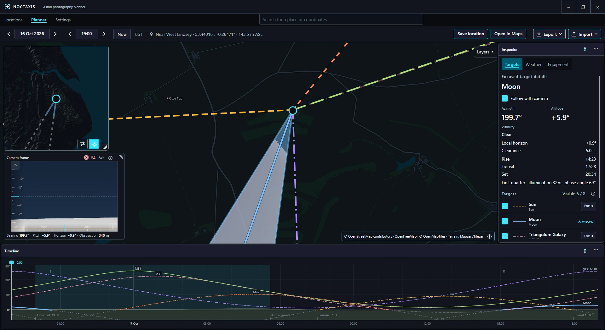

# Noctaxis

  

*CI builds and tests Windows x64, the supported platform.*
*The best-effort badge covers the test suites on Linux x64 and macOS Apple silicon.*
*The release badge covers all six packages, each built, checked and started on a runner of its own system, and publication to [Releases](https://github.com/CallyyllaC/Noctaxis/releases) when the version changes. See [CI details](docs/releasing.md#continuous-integration-and-releases).*

**[Wiki](https://github.com/CallyyllaC/Noctaxis/wiki)** · **[Getting Started](https://github.com/CallyyllaC/Noctaxis/wiki/Getting-Started)** · [Locations](https://github.com/CallyyllaC/Noctaxis/wiki/locations.md) · [Planner](https://github.com/CallyyllaC/Noctaxis/wiki/planner.md) · [Settings](https://github.com/CallyyllaC/Noctaxis/wiki/settings.md)

Noctaxis is my desktop planning application for photography and astrophotography. It brings locations, celestial targets, camera framing, terrain, light pollution, weather and time into one workspace. It gives you the information to plan a shot without deciding the composition for you.

*Most documentation was AI-Generated and human reviewed, sorry, not sorry.*

## Getting Noctaxis

Noctaxis is in active development and doesn't have a stable release yet. Start with [Installing Noctaxis](docs/user-guide/installing.md), then follow [Getting Started](https://github.com/CallyyllaC/Noctaxis/wiki/Getting-Started). The [wiki](https://github.com/CallyyllaC/Noctaxis/wiki) covers the Planner and the rest of the application. If you're working on the project itself, see [building and releasing](docs/releasing.md).

## Platform support

**Windows x64 is the officially supported platform.** I develop and test Noctaxis on Windows.

I also offer best-effort builds for Windows ARM64, Linux (x64 and ARM64), and macOS (Intel and Apple silicon). Automated checks help catch problems, but I don't test those platforms on physical hardware or promise fixes for every platform-specific issue.

The app isn't currently code-signed, so your operating system might warn you when opening it. See the [installation guide](docs/releasing.md#what-users-see-without-trusted-signing) for details.

## Licence and contributions

Noctaxis is free to use and source-available under my [AWOO Licence v2.0](LICENSE). You can use it for personal projects and paid photography. Selling or otherwise commercially exploiting the software itself requires [separate permission](COMMERCIAL-LICENSING.md).

Optional appearance themes are available through the [Awoo supporter system](AWOO-SUPPORTER-SYSTEM.md). Third-party libraries and data have their own licences and credits in [Third-party notices](THIRD_PARTY_NOTICES.md).

I welcome contributions. Please read [Contributing](CONTRIBUTING.md) and the licence terms before submitting code or other original work. For licensing enquiries, contact [licensing@awoo.ltd](mailto:licensing@awoo.ltd).

Copyright © 2026 CallyyllaC.
