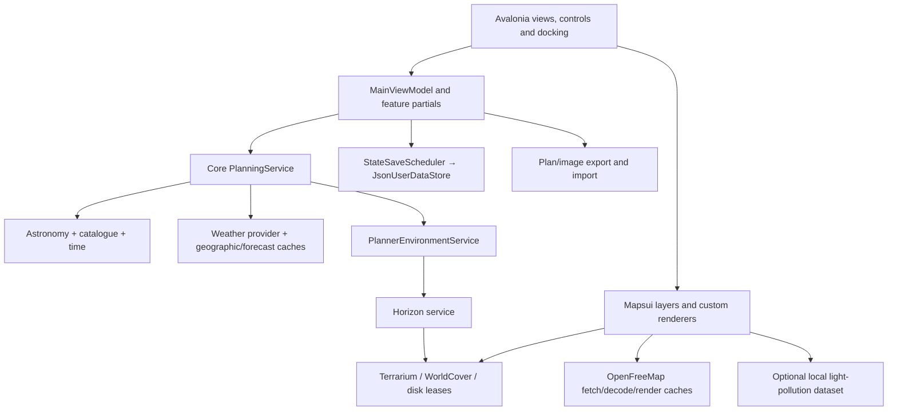

# Noctaxis — Phase 0 Independent Architecture and Engineering Audit

**Investigation:** 14 October 2026. **Report recovered and completed:** 15 October 2026.  
**Repository:** `H:\Noctaxis`. **Recorded HEAD:** `468c48f1593ac9a7d55a763e4603f7ba56bbd0c9`.  
**Scope:** discovery and evidence only; current working tree, including pre-existing uncommitted source. No fixes, production changes, benchmarks or profiling.

## 1. Executive engineering assessment

Noctaxis has a credible desktop application architecture: a framework-independent planning/domain layer, explicit data-provider boundaries, staged planning results, considerable deterministic test infrastructure, and careful treatment of several difficult concerns such as terrain leases, light-pollution dataset replacement and state-save scheduling. The evidence does not justify a wholesale architectural rewrite.

The main release concern is correctness at boundaries between independently changing state. A controlled probe against the compiled main view model confirmed that changing time while an observer's terrain is still loading can abandon the environment result, retain incomplete terrain and nevertheless mark the planner Ready. Separately, the import/time-control conversion chain loses an absolute instant in a daylight-saving overlap; the weather cache can supply a different hour from the provider's nearest-hour mapper; and unavailable environment results remain cached after the underlying provider recovers.

Six findings have reproduced failing mechanisms. Their verification levels differ: the refresh defect was exercised against the compiled view model with staged dependencies; time, weather, environment and state defects were exercised through the relevant core/conversion paths; malformed-vector testing directly exercised the decoder, with cache consequences established by source inspection. None was reproduced in a live desktop window.

The strongest further risks concern cancellation ownership, response-body deadlines, decoded-input memory budgets, and state-file ownership between processes. These are supported by code paths, but their worst-case user consequences were not simulated. Potential performance problems are a separate measurement backlog. **This investigation establishes no measured performance bottleneck.**

Recommended early-access priorities are to resolve the refresh loss, preserve absolute times through import/timeline operations, correct forecast selection and allow unavailable environmental data to recover. Validate export consistency across refresh generations before relying on exported plans as faithful representations of the screen. The remaining findings should be addressed according to exposure and evidence, without treating every cache or allocation as a release blocker.

## 2. Repository architecture and component relationships

### 2.1 Actual project structure

The solution contains six projects: `Noctaxis.Core`, `Noctaxis.Desktop`, their two test projects, `Noctaxis.GalaxyCalibration` and `Noctaxis.TerrainProbe`. Other tools include WikiCapture, WikiMarkdown, PinProbe, ViewportProbe and LightPollutionProbe. Tool presence is not evidence that those tools were executed during this audit.

| Component | Responsibility and relationships established from source |
|---|---|
| Core domain and calculations | Coordinates, sessions, targets, terrain/weather state, camera geometry, visibility and viability. No Avalonia dependency; it does contain image/export and native-backed libraries, so it is not a dependency-free mathematical kernel. |
| Core astronomy, catalogue and time | Astronomy Engine calculations, bundled catalogue lookup, NodaTime zone/instant conversion, event and path generation. |
| Core planning | Composes astronomy, weather and environmental providers into staged results. Core readiness and optional data completion are distinct concepts. |
| Core environment and terrain | Terrarium elevation, WorldCover interpretation, horizon generation, cache leases, environmental snapshots and settlement information. Completed and in-flight caches occur at several layers. |
| Core persistence and export | Versioned JSON state, location transfer, minimal plan payloads in PNG images and offline supporter verification. |
| Desktop composition root | Avalonia application startup and dependency injection, singleton application services, platform integration, themes and logging. |
| Desktop view models | MainViewModel and its partials own planner state, selected location/time, refresh generations, timeline, camera, settings, export and persistence orchestration. |
| Desktop controls and mapping | Mapsui/Avalonia map composition, vector decoding/rendering, terrain relief, light pollution, horizon/camera views, dock panels and saved-location artwork. |
| Tests | Deterministic core fixtures plus substantial headless desktop/view-model tests and source/packaging assertions. These do not substitute for native-window validation. |
| Build and distribution | Central framework/package properties, CI, six RID packaging targets, startup checks and redistribution assets. Windows x64 is the declared supported target; other packages are described as courtesy builds. |

Primary entry points: [solution](H:/Noctaxis/Noctaxis.slnx), [build properties](H:/Noctaxis/Directory.Build.props), [package versions](H:/Noctaxis/Directory.Packages.props), [application composition](H:/Noctaxis/Noctaxis.Desktop/App.axaml.cs), [startup](H:/Noctaxis/Noctaxis.Desktop/Program.cs), [planning service](H:/Noctaxis/Noctaxis.Core/Planning/PlanningService.cs).



The inspected configuration targets .NET 10 and C# 14 with nullable analysis and deterministic builds. Recorded central dependencies include Avalonia 12.1, Mapsui.Avalonia12 5.1, CommunityToolkit.Mvvm 8.4, SkiaSharp 3.119.4, OpenCvSharp 4.13, AstronomyEngine 2.1.19, NodaTime 3.3.3 and BouncyCastle 2.7.0. These are observations of configuration, not claims about current releases, vulnerability status or legal sufficiency.

### 2.2 Important execution paths followed

1. **Startup and persistence:** Program → application service registration → MainViewModel startup/initialization → state load and migration → enable saving → debounced snapshot saves → close-time flush. Initialization failure is distinct from an empty/default state.
2. **Planning refresh:** location/time/target changes → scope selection and cancellation → core computation → guarded snapshot commit → weather/environment completion. Observer-dependent terrain is reused on astronomy-only refreshes; the pending-result case is defective (D01).
3. **Environmental data:** observer → environmental snapshot cache → horizon cache/build → bounded per-build workers → elevation tiles and selective land-cover interpretation → progressive/full horizon → UI terrain and metadata.
4. **Map imagery:** viewport/layer changes → shared tile fetching → disk/raw caches → vector or raster decoding → theme-specific rendering → Mapsui layers. Main and picture-in-picture consumers have shared and borrowed resources.
5. **Time and target derivations:** selected instant/location → local controls, timeline window, target paths/events, camera framing and shot viability. Several results have separate cancellation/generation mechanisms.
6. **Saved locations:** persistent location → thumbnail service/cache validation → preview scene loading → themed control rendering, with a legacy bitmap also loaded.
7. **Plan images:** current planner state → image rendering + embedded minimal plan; image/file/clipboard → PNG metadata parsing → validated plan → view-model state application.

## 3. Investigation coverage and limitations

### 3.1 Method and snapshot

The original investigation inventoried source, test, tooling, packaging and workflow files; searched symbols and patterns for asynchronous work, blocking operations, caches, resource ownership and error handling; then followed the paths above across projects. Findings were derived from those paths rather than from performance TODOs or earlier audit reports. No other reviewer's findings were consulted.

The recorded inventory contained 571 files in the selected roots: Core 80 files / 67 C# files; Desktop 242 / 161; Core.Tests 60 / 49; Desktop.Tests 140 / 139; tools 18; scripts 15; packaging 8; workflows 4; and two files each in the calibration and terrain-probe projects. This is an inventory, **not a claim that every line or asset was audited**.

At investigation start, Git reported 307 changed/untracked entries: 135 modified, 7 deleted and 165 untracked. The audit therefore describes a working-tree snapshot, not the recorded commit alone. Recovery found 321 entries before creating this report. Those intervening changes were not investigated or attributed. Exact source references below are the locations recorded during the original investigation; use the named symbols if later edits shift lines.

The original in-memory inventory/hash store was unavailable on recovery. A full source-hash comparison cannot be reported. Recovery wrote this report and its JSON companion and read the surviving diagnostic harness; it did not restart broad code exploration or rerun tests.

### 3.2 Coverage matrix

| Area | Investigation performed | Evidence still missing |
|---|---|---|
| Project boundaries, composition, startup | Source inspection and dependency tracing | Full solution/tool build and installer execution |
| Astronomy, time, catalogue, visibility/viability | Algorithm and data-flow inspection; targeted time conversion probe | Independent scientific accuracy corpus, polar/extreme-date validation |
| Planner state and concurrency | Deep refresh/commit inspection; compiled VM interleaving probe | Live GUI reproduction and exhaustive interleaving tests |
| Weather | Provider/cache/mapper inspection and deterministic adjacent-hour probe | Live API schema/outage/variable-combination tests |
| Terrain/environment | Cache, cancellation, data validity, worker and lease paths; recovery probe | Real network recovery, every raster format edge case, long-session load |
| Vector/raster maps and PiP | Fetch/decode/render/cache/lifetime inspection; malformed vector decoder probe | Native GPU rendering, actual frame latency, long-session device memory |
| Light pollution and dataset lifecycle | Install/read/remove generation and lease paths inspected | Actual dataset install/removal during active native rendering |
| State, import/export and supporter validation | Migration/save/input boundary inspection; malformed-state probe; selected existing tests | Multi-process race reproduction; coherent export during pending timeline; independent cryptographic audit |
| Location artwork, themes, docking/accessibility | Source-level ownership, layout/state and fallback inspection | Real screen reader, focus/navigation, DPI/multi-monitor, visual acceptance |
| Tests and developer workflow | Test inventory, representative fixture inspection, 77 targeted cases | Entire suite, coverage measurement, mutation testing |
| CI and packaging | Workflow/scripts/native asset and notice checks inspected | CI run verification, actual archives, clean-machine launch, signing/notarization |
| Auxiliary tools | Project/entry-point inventory and selected source | Complete functional review of every calibration/probe/wiki utility; none executed |
| Documentation, legal, assets | README/CONTRIBUTING and relevant build/distribution declarations | Exhaustive documentation consistency, artwork/data provenance and legal review |
| Dependency security | Direct dependencies and external input paths inspected | Current vulnerability/advisory scan, transitive SBOM review, penetration testing |

### 3.3 Executed correctness checks

The original investigation used .NET SDK 10.0.401 and isolated Release output directories under `artifacts/independent-review`.

| Evidence | Selection | Result |
|---|---|---|
| T01 | Core: PersistenceAndWeatherTests, NoctaxisPlanTests, StateCompatibilityTests | 63 passed, 0 failed, 0 skipped |
| T02 | Desktop filter naming scheduler/timeline/plan-image classes | 8 passed: only scheduler cases matched because other files use a partial MainViewModelTests class |
| T03 | Corrected method-name filters for plan restoration/round-trip, 24-hour timeline anchoring and PNG plan embedding | 6 passed, 0 failed, 0 skipped |
| Reproduction harness | Six deterministic defect probes, including one staged compiled view-model scenario | Completed successfully; failing application behaviors described in D01–D06 |

**Total: 77 existing test cases passed.** This is narrow correctness evidence, not a full-suite result. Initial Core restore failed with NU1301 under network restrictions; the permitted retry restored and built successfully. Desktop tests compiled the relevant Core/Desktop/test code. No benchmark-named tests or performance tools were selected.

The surviving [probe project](H:/Noctaxis/artifacts/independent-review/repros/Repros.csproj), [core/decoder probes](H:/Noctaxis/artifacts/independent-review/repros/Program.cs), [view-model probe](H:/Noctaxis/artifacts/independent-review/repros/DesktopProbe.cs) and [serial synchronization context](H:/Noctaxis/artifacts/independent-review/repros/SingleThreadContext.cs) are ignored local artifacts, not production changes. The desktop probe uses existing test helpers through reflection. Its serial continuation pump is not a real Avalonia dispatcher/window.

Full TRX files and separate raw test logs were not recovered; the results and output excerpts below are preserved from the original session record. Commands, filters and outputs are also retained in the JSON companion. Re-running the probes requires the isolated compiled assemblies they reference and may need adjustment if source/test helpers change.

### 3.4 Classification and severity

- **Verified correctness defect:** reproduced incorrect mechanism, with any unexecuted integration consequence stated separately.
- **Strongly supported architectural problem:** concrete ownership or state-boundary problem supported by source.
- **Potential performance bottleneck:** plausible expense with a future measurement plan; no measured slowness claimed.
- **Maintainability or testability concern:** demonstrable change/validation burden, not a style preference.
- **Reliability or platform risk:** a supported failure path whose production occurrence or full consequence was not reproduced.
- **Positive engineering finding:** a supported property worth preserving.
- **Unverified hypothesis requiring further investigation:** insufficient evidence to recommend a behavior-changing fix.

High severity denotes material incorrect behavior in an ordinary workflow. Medium denotes important but bounded correctness/recovery/resource risks. Low denotes limited-impact or maintainability concerns. P1 means resolve or explicitly validate/accept before early access; P2 means early-access hardening; P3 means measure or improve only when warranted. No critical-severity defect is established.

## 4. Verified defects


### D01 — An astronomy refresh abandons a pending observer environment result

**Classification:** Verified correctness defect. **Component:** Desktop planner refresh coordination.  
**Confidence:** High. **Severity:** high. **Priority:** P1.  
**Release relevance:** Recommend resolving before early access: a normal time adjustment can leave incomplete terrain with a Ready status.

**Source:** [Noctaxis.Desktop/ViewModels/MainViewModel.cs:1987](H:/Noctaxis/Noctaxis.Desktop/ViewModels/MainViewModel.cs:1987) — `SchedulePlannerRefresh`; [Noctaxis.Desktop/ViewModels/MainViewModel.cs:2014](H:/Noctaxis/Noctaxis.Desktop/ViewModels/MainViewModel.cs:2014) — `RefreshNowAsync`; [Noctaxis.Desktop/ViewModels/MainViewModel.cs:2157](H:/Noctaxis/Noctaxis.Desktop/ViewModels/MainViewModel.cs:2157) — `CommitCoreAsync`; [Noctaxis.Desktop/ViewModels/MainViewModel.cs:2200](H:/Noctaxis/Noctaxis.Desktop/ViewModels/MainViewModel.cs:2200) — `CommitEnvironmentAsync`.

**Problem and mechanism:** One refresh cancellation/generation governs both astronomy and observer-dependent environment completion. A new astronomy-only request cancels the previous observer refresh, but does not request or rejoin its pending environment work. It copies the previous terrain/environment even when incomplete.

**Evidence:**

- SchedulePlannerRefresh cancels _refreshCancellation and increments generation for every scope (recorded lines 1987–2000).
- RefreshNowAsync requests environment work only for Observer scope (2014–2040). Astronomy scope can complete with environment and ground terrain NotRequired.
- CommitCoreAsync reuses prior terrain/environment for an astronomy refresh at effectively the same observer (2167–2174), without requiring that environment completion has occurred.
- CommitEnvironmentAsync rejects the old result on cancellation/generation mismatch. The replacement refresh can reach Ready (2053–2064) without any remaining consumer that can publish complete terrain.
- The staged compiled-view-model probe observed one environment request, null Environment, incomplete Terrain and Phase=Ready after the old environment result was released.

**Reproduction:**

1. Create the real compiled MainViewModel using existing MainViewModelTests.StagedPlanning, FakeStore and FakeExporter helpers; run continuations on the surviving serial SynchronizationContext.
2. Commit a new observer at (53, -1); complete core and weather and allow the initial terrain-bearing snapshot to commit, but hold full environment completion.
3. Call StepTime(30), causing an Astronomy refresh; complete its core/weather work and await the new refresh.
4. Complete the original environment request and await the old refresh.
5. Inspect Snapshot and PlannerRefresh. Recorded result: environmentRequests=1; environmentNull=True; terrainComplete=False; Phase=Ready; GroundTerrainState/EnvironmentMetadataState=NotRequired.

**Consequences:** The planner can stop receiving the full terrain/environment for the selected observer until another observer refresh or equivalent invalidation occurs. Dependent presentation can remain incomplete while the overall status promises readiness.

**Recommended action or validation:** Give observer-dependent work a lifecycle independent of astronomy changes, or explicitly rejoin pending environment work for the current observer. Reusing a completed result is valid; dropping the only publisher of an incomplete result is not. Add the exact interleaving as a deterministic regression test before changing coordination.

**Regression risks:** Do not allow stale observer results to commit, duplicate expensive terrain builds, or make time changes wait unnecessarily for optional data. Preserve completed-terrain reuse and current core-first responsiveness.

**Evidence limits:** This is a compiled view-model reproduction with existing fakes, not a native GUI capture or real terrain download.


### D02 — Absolute plan/timeline instants are converted through ambiguous minute-only local time

**Classification:** Verified correctness defect. **Component:** Plan-image import and timeline/time controls.  
**Confidence:** High for the conversion failure; full image/timeline UI scenario not executed. **Severity:** high. **Priority:** P1.  
**Release relevance:** Astronomy plans must retain the requested instant. The daylight-saving overlap changes the time by an hour; second precision is lost outside overlaps too.

**Source:** [Noctaxis.Desktop/ViewModels/MainViewModel.PlanImage.cs:228](H:/Noctaxis/Noctaxis.Desktop/ViewModels/MainViewModel.PlanImage.cs:228) — `ImportPlanImage / ApplyPlan`; [Noctaxis.Desktop/ViewModels/MainViewModel.TimeBar.cs:64](H:/Noctaxis/Noctaxis.Desktop/ViewModels/MainViewModel.TimeBar.cs:64) — `SetLocalDateTime`; [Noctaxis.Desktop/ViewModels/MainViewModel.cs:1842](H:/Noctaxis/Noctaxis.Desktop/ViewModels/MainViewModel.cs:1842) — `ApplyLocalDateTime`; [Noctaxis.Core/Time/TimeZoneResolver.cs:50](H:/Noctaxis/Noctaxis.Core/Time/TimeZoneResolver.cs:50) — `ResolveLocal`; [Noctaxis.Desktop/ViewModels/MainViewModel.Timeline.cs:77](H:/Noctaxis/Noctaxis.Desktop/ViewModels/MainViewModel.Timeline.cs:77) — `TimelineSelectedInstant and timeline selection conversion`.

**Problem and mechanism:** Import starts with an unambiguous UTC Instant, converts it to local date/time, formats only hours/minutes into controls, and resolves that wall time again with lenient zone mapping. The second occurrence of a repeated local time cannot survive this route. Timeline selection also round-trips absolute offsets through local time.

**Evidence:**

- Plan application uses TimeUtc.InZone(...).LocalDateTime and SetLocalDateTime rather than retaining TimeUtc as the authoritative instant (PlanImage.cs recorded lines 228–258).
- SetLocalDateTime formats TimeText as HH:mm. ResolveLocal uses InZoneLeniently.
- The direct conversion probe transformed 2026-10-25T01:30:45Z in Europe/London to 2026-10-25T00:30:00Z.
- Timeline.cs recorded lines 91–113 likewise convert an absolute selection through local/snap/lenient resolution. Existing passing whole-minute, non-overlap plan tests do not cover this boundary.

**Reproduction:**

1. Take Instant.FromUtc(2026,10,25,1,30,45), the later 01:30 in Europe/London.
2. Convert to LocalDateTime in Europe/London, then keep only its date/hour/minute as the controls do.
3. Call TimeZoneResolver.ResolveLocal with that date/time and zone.
4. Observe 2026-10-25T00:30:00Z instead of the original instant.

**Consequences:** A reopened or selected plan can point at the wrong sky/time and weather hour. Ordinary seconds are discarded; the autumn overlap adds a one-hour error.

**Recommended action or validation:** Keep Instant authoritative for imports and absolute timeline selections. Format local controls for display without using them to reconstruct already-known instants. For actual wall-time edits, specify and test an ambiguity policy.

**Regression risks:** Cover both daylight-saving folds, spring gaps, zone changes, timeline snapping and second precision. Preserve intended minute snapping for explicit user actions without applying it silently to imported absolute times.

**Evidence limits:** The failing conversion chain was executed directly. A PNG import through a live window and every timeline interaction were not exercised.

**Supporting API reference:** [NodaTime DateTimeZone: lenient mapping semantics](https://nodatime.org/3.3.x/api/NodaTime.DateTimeZone.html) — Lenient mapping chooses the earlier occurrence for ambiguous local times.


### D03 — Geographic weather cache can return the wrong forecast hour

**Classification:** Verified correctness defect. **Component:** Weather cache and Open-Meteo mapping.  
**Confidence:** High. **Severity:** medium. **Priority:** P1.  
**Release relevance:** Visible planning information can be stale by an hour during ordinary time changes without any provider failure.

**Source:** [Noctaxis.Core/Weather/OpenMeteoWeatherProvider.cs:39](H:/Noctaxis/Noctaxis.Core/Weather/OpenMeteoWeatherProvider.cs:39) — `GeographicWeatherCache.TryGet`; [Noctaxis.Core/Weather/OpenMeteoWeatherProvider.cs:140](H:/Noctaxis/Noctaxis.Core/Weather/OpenMeteoWeatherProvider.cs:140) — `OpenMeteoWeatherProvider.GetWeatherAsync`; [Noctaxis.Core/Weather/OpenMeteoWeatherProvider.cs:258](H:/Noctaxis/Noctaxis.Core/Weather/OpenMeteoWeatherProvider.cs:258) — `OpenMeteoMapper.TryMap`.

**Problem and mechanism:** The geographic cache accepts samples within 60 minutes of the requested instant and ranks by spatial distance. This can short-circuit the nearest-hour selection made by the hourly forecast mapper.

**Evidence:**

- Cache filtering uses absolute forecast-time distance below 60 minutes, then orders spatially (recorded lines 39–59).
- GetWeatherAsync checks this cache before the retained forecast/mapper path.
- With hourly cloud values 10 at 10:00 and 90 at 11:00, a 10:00 cached sample is returned for 10:50, while mapping the same hourly data chooses 11:00.

**Reproduction:**

1. Construct a two-hour forecast with timestamps 10:00/11:00 UTC and cloud cover 10/90.
2. Map and store the 10:00 sample at one coordinate in GeographicWeatherCache.
3. Request the same coordinate at 10:50, within cache TTL.
4. Compare the cache result with OpenMeteoMapper.TryMap over the existing hourly forecast: cache=10:00/cloud10; mapper=11:00/cloud90.

**Consequences:** Displayed weather depends on cache history rather than the same forecast-selection rule used for an uncached request. This can misinform a planned observation.

**Recommended action or validation:** Use retained forecast data as the canonical source for time selection, or key mapped entries by the selected forecast hour and relevant request identity. Test adjacent-hour boundaries and multiple cached hours.

**Regression risks:** Preserve geographic reuse, offline availability and network request reduction. Do not fix a selection error by forcing an API request on every time change.

**Evidence limits:** Deterministic cache/mapper probe, not a real API call. Configuration-field identity was considered but a separate user-visible defect was not established.


### D04 — Unavailable environmental results remain authoritative after provider recovery

**Classification:** Verified correctness defect. **Component:** Environmental and horizon completed-result caches.  
**Confidence:** High for same-service recovery failure. **Severity:** medium. **Priority:** P1.  
**Release relevance:** A transient initial data outage can persist through ordinary retries during the session.

**Source:** [Noctaxis.Core/Environment/PlannerEnvironmentService.cs:56](H:/Noctaxis/Noctaxis.Core/Environment/PlannerEnvironmentService.cs:56) — `GetSnapshotAsync / BuildAndCacheAsync`; [Noctaxis.Core/Terrain/TerrainProviders.cs:224](H:/Noctaxis/Noctaxis.Core/Terrain/TerrainProviders.cs:224) — `HorizonService completed-result lookup`; [Noctaxis.Core/Terrain/TerrainProviders.cs:432](H:/Noctaxis/Noctaxis.Core/Terrain/TerrainProviders.cs:432) — `Completed horizon publication`; [Noctaxis.Core/Environment/CompletedResultCache.cs](H:/Noctaxis/Noctaxis.Core/Environment/CompletedResultCache.cs) — `CompletedResultCache`; [Noctaxis.Core/Environment/TerrariumTerrainProvider.cs:381](H:/Noctaxis/Noctaxis.Core/Environment/TerrariumTerrainProvider.cs:381) — `Recent failure handling`.

**Problem and mechanism:** Completed-result caches admit results with unavailable or incomplete terrain and do not give those outcomes a freshness/retry policy. Lower-level transient-failure expiry cannot help when a higher cache satisfies the request without consulting the recovered provider.

**Evidence:**

- PlannerEnvironmentService caches completed snapshots, including unavailable coverage, in a small capacity-limited cache without an outcome-sensitive expiry.
- HorizonService also retains completed profiles without making availability a cache-admission requirement.
- A stub horizon changed from unavailable to available; a second environmental request returned the identical snapshot with no second horizon call: calls=1, sameSnapshot=True, coverage=False.

**Reproduction:**

1. Create PlannerEnvironmentService with a stub IHorizonService initially returning a no-coverage profile.
2. Request one observer snapshot and allow completion.
3. Change the stub to return an available profile.
4. Request the same observer again without unrelated invalidation; observe that the provider is not called and the original unavailable snapshot is returned.

**Consequences:** Users may need an explicit invalidation, eviction or application restart to recover from transient data unavailability. A small entry count does not make cached failures fresh.

**Recommended action or validation:** Define availability-aware admission/expiry and explicit retry semantics at every completed-result layer. Retain stable successful data aggressively, but allow unavailable/partial outcomes to be rebuilt when retry or source generation warrants it.

**Regression risks:** Avoid retry storms during a real outage and avoid repeatedly recalculating valid static terrain. Distinguish a successfully completed unavailable result from a faulted task and from an intentionally limited profile.

**Evidence limits:** The environmental cache recovery failure is executed evidence; lower-level cache interactions are source-supported. No real offline-to-online transition was run.


### D05 — A structurally invalid location entry escapes state-file recovery

**Classification:** Verified correctness defect. **Component:** JSON persistence and legacy migration.  
**Confidence:** High. **Severity:** medium. **Priority:** P2.  
**Release relevance:** Malformed local state can repeatedly prevent successful startup; not shown to be produced by normal saving.

**Source:** [Noctaxis.Core/Persistence/JsonUserDataStore.cs:82](H:/Noctaxis/Noctaxis.Core/Persistence/JsonUserDataStore.cs:82) — `LoadAsync recovery catch filter`; [Noctaxis.Core/Persistence/JsonUserDataStore.cs:154](H:/Noctaxis/Noctaxis.Core/Persistence/JsonUserDataStore.cs:154) — `ToDomain legacy location migration`; [Noctaxis.Desktop/ViewModels/MainViewModel.cs:519](H:/Noctaxis/Noctaxis.Desktop/ViewModels/MainViewModel.cs:519) — `Startup error handling`.

**Problem and mechanism:** A deserializable Locations array containing null reaches migration code that dereferences each location. NullReferenceException is outside the recovery filter, so the malformed file is neither successfully loaded nor handled by the expected quarantine/default recovery path.

**Evidence:**

- LoadAsync handles JSON, I/O, authorization, argument and invalid-data exceptions but not the null dereference generated by migration.
- The version<4 migration accesses each location's ObserverElevation.
- A version-3 state with Locations:[null] threw NullReferenceException and remained in place.

**Reproduction:**

1. Use JsonUserDataStore to write a minimal version-3 state to an isolated fixture directory.
2. Replace its Locations property with [null], retaining valid JSON.
3. Call LoadAsync.
4. Observe NullReferenceException and that the state file remains present. The surviving probe uses only its own state-fixture path.

**Consequences:** The same structurally invalid file can fail every subsequent initialization. Application startup handles failure at a higher level, but that does not repair/quarantine the bad state.

**Recommended action or validation:** Validate deserialized collection elements and required domain fields before migration and route invalid input through the intentional recovery policy. Prefer explicit validation to broadly swallowing programmer NullReferenceExceptions.

**Regression risks:** Preserve valid legacy records, migration fixtures and backup/recovery behavior. Do not silently drop legitimate locations or overwrite the only recoverable original.

**Evidence limits:** Proven for the version-3/null-location fixture. No claim that all malformed version-4 shapes fail or that ordinary application saving produces this input.


### D06 — Malformed vector lengths escape decoder recovery and can leave a faulted cached task

**Classification:** Verified correctness defect. **Component:** Vector tile decoder and themed decoded cache.  
**Confidence:** High for decoder contract violation; high source confidence for cache consequence. **Severity:** medium. **Priority:** P2.  
**Release relevance:** Corrupt cached or server tile input can repeatedly fail a tile until eviction/recreation; no whole-application crash was demonstrated.

**Source:** [Noctaxis.Desktop/Mapping/Vector/VectorTile.cs:220](H:/Noctaxis/Noctaxis.Desktop/Mapping/Vector/VectorTile.cs:220) — `ProtobufReader.Bytes`; [Noctaxis.Desktop/Mapping/Vector/VectorTile.cs:75](H:/Noctaxis/Noctaxis.Desktop/Mapping/Vector/VectorTile.cs:75) — `DecodeLayer extent conversion`; [Noctaxis.Desktop/Mapping/Vector/ThemedVectorTileSource.cs:126](H:/Noctaxis/Noctaxis.Desktop/Mapping/Vector/ThemedVectorTileSource.cs:126) — `GetDecodedAsync`; [Noctaxis.Desktop/Mapping/Vector/ThemedVectorTileSource.cs:149](H:/Noctaxis/Noctaxis.Desktop/Mapping/Vector/ThemedVectorTileSource.cs:149) — `LoadAsync`.

**Problem and mechanism:** Length conversion uses checked int casts that throw OverflowException, while the decoded source only treats InvalidDataException as recoverable corrupt input. The task is stored before decoding finishes; the fault bypasses normal cleanup/discard logic.

**Evidence:**

- VectorTile.Decode on bytes 1a 80 80 80 80 08 throws OverflowException from the oversized protobuf length.
- ThemedVectorTileSource.LoadAsync catches InvalidDataException, not this overflow.
- GetDecodedAsync retains the created task. The normal removal path after the try/catch is bypassed on an unexpected decoder exception.

**Reproduction:**

1. Call VectorTile.Decode(new byte[] {0x1a,0x80,0x80,0x80,0x80,0x08}).
2. Observe OverflowException instead of the malformed-input exception expected by LoadAsync.
3. For future integration validation, place that payload behind a fake tile fetcher and request the tile twice; the latter cache consequence was not executed in this phase.

**Consequences:** A corrupt input can remain a faulted decoded entry and may leave the invalid disk payload intact, so ordinary retries do not necessarily recover. This is a robustness issue, not evidence of remote code execution.

**Recommended action or validation:** Validate sizes/tags before casts and normalize malformed-input failures to a defined decoder contract. Ensure faulted in-flight entries are removed in identity-safe cleanup and discard known-invalid raw payloads.

**Regression risks:** Do not hide genuine programming faults, remove a newer replacement task by key alone, or reject valid protobuf encodings. Add small malformed-input tests without allocating huge buffers.

**Evidence limits:** Only the decoder failure was directly executed. Repeated fetch/render behavior and native UI consequences remain source-based predictions.


## 5. Architectural and design concerns

### A01 — Environmental build ownership breaks cancellation across service layers

**Classification:** Strongly supported architectural problem. **Component:** Environment/horizon orchestration.  
**Confidence:** High for ownership mechanism; user cost unmeasured. **Severity:** medium. **Priority:** P1.  
**Release relevance:** Validate alongside D01: correcting publication without correcting abandoned-work ownership can preserve unnecessary background work.

**Source:** [Noctaxis.Core/Environment/PlannerEnvironmentService.cs:56](H:/Noctaxis/Noctaxis.Core/Environment/PlannerEnvironmentService.cs:56) — `GetSnapshotAsync / BuildAndCacheAsync`; [Noctaxis.Core/Terrain/TerrainProviders.cs:224](H:/Noctaxis/Noctaxis.Core/Terrain/TerrainProviders.cs:224) — `HorizonService shared requests and consumers`.

**Problem and mechanism:** The environmental service shares a producer started with CancellationToken.None, while individual callers only cancel their WaitAsync. A downstream horizon service may correctly count consumers, but its consumer here remains uncancellable. Per-build concurrency limits do not bound the number of simultaneous observer builds.

**Evidence:**

- The recorded BuildAndCacheAsync/BuildAsync path uses CancellationToken.None; GetSnapshotAsync applies caller cancellation to waiting.
- The _snapshots in-flight dictionary is keyed by observer and does not impose a global active-build cap.
- HorizonService's consumer cancellation cannot stop work while its environmental caller remains interested indefinitely. Clearing a cache dictionary alone does not cancel the producer.

**Consequences:** Rapid observer changes can leave obsolete terrain work running after the view model has abandoned it. Network, CPU and memory use may accumulate across concurrent builds. Magnitude and user-visible latency are unmeasured.

**Recommended action or validation:** Write a controlled multi-consumer cancellation test first. Give shared producers explicit lifetime ownership, with cancellation when the last consumer leaves or a deliberately bounded background policy. Consider a global work bound if measurements justify it. P01 specifies a later load scenario.

**Regression risks:** Do not use the first caller's cancellation token as the shared producer token: one caller must not cancel work still needed by another. Preserve coalescing and safe invalidation.

**Evidence limits:** Source-supported lifecycle mismatch; no cancellation-load benchmark or peak resource measurement was run.


### A02 — Planner state coherence depends on several separate mutable generations

**Classification:** Strongly supported architectural problem. **Component:** MainViewModel and derived planner results.  
**Confidence:** High for coordination burden; not every interleaving is defective. **Severity:** medium. **Priority:** P2.  
**Release relevance:** Make focused ownership improvements around reproduced failures; a large rewrite is not an early-access prerequisite.

**Source:** [Noctaxis.Desktop/ViewModels/MainViewModel.cs:1987](H:/Noctaxis/Noctaxis.Desktop/ViewModels/MainViewModel.cs:1987) — `Refresh scheduling and snapshot commits`; [Noctaxis.Desktop/ViewModels/MainViewModel.Timeline.cs:149](H:/Noctaxis/Noctaxis.Desktop/ViewModels/MainViewModel.Timeline.cs:149) — `Timeline path requests`; [Noctaxis.Desktop/ViewModels/MainViewModel.PlanImage.cs:56](H:/Noctaxis/Noctaxis.Desktop/ViewModels/MainViewModel.PlanImage.cs:56) — `CreateExportPng`; [Noctaxis.Desktop/ViewModels/MainViewModel.CameraFrame.cs](H:/Noctaxis/Noctaxis.Desktop/ViewModels/MainViewModel.CameraFrame.cs) — `Camera-derived state`.

**Problem and mechanism:** Session, snapshot, terrain, timeline, focused target, camera and export inputs are updated by different mechanisms. Generation checks protect individual operations, but consumers can still read a combination of results from different generations. File size alone is not the defect; cross-result coherence is the difficult contract.

**Evidence:**

- D01 is a reproduced case where generation rejection prevents stale publication but also loses necessary current-observer completion.
- Timeline and export read independently maintained state rather than a single validated generation-tagged result bundle.
- The main view model is split into partials but shared mutable state and suppression/refresh responsibilities still cross those files.

**Consequences:** Changes to one feature require understanding ordering assumptions elsewhere. Tests for isolated successful refreshes can miss transitions between partial and complete states. U01 describes an export-coherence hypothesis needing validation.

**Recommended action or validation:** Define invariants for observer identity, instant/window identity and completion of each derived result. Introduce narrowly scoped ownership/coherence boundaries where those invariants are currently implicit; an immutable export input bundle and independent observer work ownership are concrete candidates. Do not split files merely to reduce line counts.

**Regression risks:** Preserve core-first responsiveness, live camera edits, focus ownership and cached results. Avoid centralizing unrelated rendering state or creating a generic orchestration framework without a demonstrated need.

**Evidence limits:** This is supported architectural coupling, not proof that every derived view is currently inconsistent.


## 6. Potential performance bottlenecks and proposed benchmarks

All entries in this section are **potential performance bottlenecks**. No benchmarks, profiling, frame timings, allocation measurements or application throughput measurements were performed. Priority is the order in which to seek evidence, not proof of severity. A costly operation can be rare, off-thread or hidden behind adequate caching; measure the end-to-end user path before optimizing it.

### P01 — Obsolete observer builds may accumulate behind apparently cancelled requests

**Classification:** Potential performance bottleneck. **Component:** Environmental work.  
**Priority:** P1. **Confidence:** High mechanism confidence; bottleneck unverified. **Severity:** potential medium impact, unmeasured; not a demonstrated release blocker.

**Source and path:** [Noctaxis.Core/Environment/PlannerEnvironmentService.cs:56](H:/Noctaxis/Noctaxis.Core/Environment/PlannerEnvironmentService.cs:56) — `GetSnapshotAsync`; [Noctaxis.Core/Terrain/TerrainProviders.cs:224](H:/Noctaxis/Noctaxis.Core/Terrain/TerrainProviders.cs:224) — `HorizonService`.

**Mechanism:** Observer changes can start distinct environmental builds that continue after their callers cancel, as described in A01. A six-worker per-horizon limit is not a total service limit.

**Resources:** CPU, network I/O, allocation, memory, concurrency.

**Proposed scenario:** After correctness/lifetime tests, compare one observer request with a controlled sequence of 20 observer moves while earlier terrain is pending. Run cold-cache, warm-cache and unavailable-source cases; do not mix them into one average.

**Required measurements:** Peak active observer builds and tile workers; Cancelled callers versus completed obsolete producers; Fetched bytes and distinct tiles; CPU and allocation per accepted result; Peak working set and GC pressure; Time until the final observer has usable terrain and UI dispatch latency.

**Suspected user impact:** Background work for discarded observers may compete with the final requested location.

**Action after validation:** Measure cancellation propagation and active-work bounds before tuning worker counts. If confirmed, fix ownership/coalescing and only then tune parallelism.

**Regression risks:** Multi-consumer work sharing, cache reuse and valid partial terrain must survive.

### P02 — Synchronous astronomy/event computation can occur before the first asynchronous boundary

**Classification:** Potential performance bottleneck. **Component:** Planning and astronomy.  
**Priority:** P1. **Confidence:** High for synchronous work; actual UI cost unmeasured. **Severity:** potential medium impact, unmeasured; not a demonstrated release blocker.

**Source and path:** [Noctaxis.Core/Planning/PlanningService.cs:202](H:/Noctaxis/Noctaxis.Core/Planning/PlanningService.cs:202) — `Core calculation setup`; [Noctaxis.Core/Astronomy/AstronomyService.cs:43](H:/Noctaxis/Noctaxis.Core/Astronomy/AstronomyService.cs:43) — `Calculate`; [Noctaxis.Core/Astronomy/AstronomyService.cs:127](H:/Noctaxis/Noctaxis.Core/Astronomy/AstronomyService.cs:127) — `Event calculation`.

**Mechanism:** Task.FromResult(astronomy.Calculate(...)) evaluates Calculate synchronously. Event searches use repeated samples; catalogue event calculations and paths/timeline can repeat related work at different sample intervals. Cancellation checks outside a calculation do not interrupt its inner loop.

**Resources:** CPU, allocation, UI latency, cancellation latency.

**Proposed scenario:** Trace a normal date/time change and repeated scrubbing with the maximum supported visible-target configuration, representative catalogue targets and polar/mid-latitude observers. Separate position, events, path generation and optional terrain costs.

**Required measurements:** Calling thread and UI dispatch delay; CPU samples by position/event/path function; Number of repeated astronomical evaluations per accepted refresh; Allocation and collections; Time to observe cancellation and count of discarded completed calculations.

**Suspected user impact:** If this work runs on the UI continuation and takes material time, controls may stall; if it is cheap enough or already off-thread in the relevant path, there may be no bottleneck.

**Action after validation:** First establish thread ownership and measured cost. Then consider separating instant positions from daily events or reusing appropriately keyed calculations; offload only where thread-safety and cancellation are clear.

**Regression risks:** Event precision, time-zone boundaries, target identity, refraction and thread-safety of dependencies.

### P03 — Catalogue search performs repeated normalization and ranking synchronously

**Classification:** Potential performance bottleneck. **Component:** Local target search and UI search orchestration.  
**Priority:** P2. **Confidence:** High for algorithm shape; user latency unverified. **Severity:** potential medium impact, unmeasured; not a demonstrated release blocker.

**Source and path:** [Noctaxis.Core/Catalogues/TargetCatalogue.cs](H:/Noctaxis/Noctaxis.Core/Catalogues/TargetCatalogue.cs) — `LocalTargetSearchService.SearchAsync / MatchRank`; [Noctaxis.Desktop/ViewModels/CelestialObjectViewModels.cs:140](H:/Noctaxis/Noctaxis.Desktop/ViewModels/CelestialObjectViewModels.cs:140) — `SearchAsync`.

**Mechanism:** The inspected local search returns Task.FromResult around synchronous filtering/ranking and repeatedly normalizes strings/aliases. A debounce limits request frequency but does not make the surviving request asynchronous.

**Resources:** CPU, allocation, UI latency.

**Proposed scenario:** Use the shipped catalogue with incremental common/rare/alias/no-match queries on a representative lower-power machine. Include cultures and rapid replacement of a pending query.

**Required measurements:** Search execution thread; End-to-end input-to-result latency including p95; Normalization and comparison counts; Bytes allocated per query; Cancellation behavior and stale results.

**Suspected user impact:** A sufficiently expensive surviving query could interrupt typing. The catalogue may also be small enough in practice for this to be negligible.

**Action after validation:** Measure first; if material, precompute stable normalized keys and consider cancellation-aware background evaluation rather than adding another debounce delay.

**Regression risks:** Alias ranking, Unicode/culture handling, result ordering and focus/selection preservation.

### P04 — Expired map metadata may serialize repeated network refresh attempts before cached tiles are read

**Classification:** Potential performance bottleneck. **Component:** OpenFreeMap template resolution.  
**Priority:** P2. **Confidence:** High source confidence; outage latency not simulated. **Severity:** potential medium impact, unmeasured; not a demonstrated release blocker.

**Source and path:** [Noctaxis.Desktop/Mapping/Vector/OpenFreeMapTileFetcher.cs:82](H:/Noctaxis/Noctaxis.Desktop/Mapping/Vector/OpenFreeMapTileFetcher.cs:82) — `FetchCoreAsync`; [Noctaxis.Desktop/Mapping/Vector/OpenFreeMapTileFetcher.cs:113](H:/Noctaxis/Noctaxis.Desktop/Mapping/Vector/OpenFreeMapTileFetcher.cs:113) — `ResolveTemplateAsync`.

**Mechanism:** Template resolution occurs before local tile retrieval. An expired TileJSON record triggers work under a shared template gate; fallback to the old record does not advance its retrieved timestamp. Subsequent tile callers can retry the same failed refresh serially.

**Resources:** Network I/O, queueing, latency.

**Proposed scenario:** Seed valid cached tiles and an expired manifest, then use a deterministic failing or delayed metadata endpoint. Pan once and compare against a fresh-manifest/offline baseline.

**Required measurements:** Metadata request count per viewport; Time waiting for template gate; Cached tile time-to-first-display; Retry spacing; Queue length and cancellation response.

**Suspected user impact:** Cached basemap availability may depend unnecessarily on a repeatedly failing metadata service. No actual duration or outage behavior was measured.

**Action after validation:** If reproduced, allow cached rendering while a shared refresh attempt/backoff policy manages metadata freshness.

**Regression risks:** Do not keep obsolete templates forever, bypass provider changes, or introduce a retry loop.

### P05 — PNG plan metadata processing decodes/re-encodes image content

**Classification:** Potential performance bottleneck. **Component:** Plan image import/export.  
**Priority:** P2. **Confidence:** High for extra image work; normal-image cost unmeasured. **Severity:** potential medium impact, unmeasured; not a demonstrated release blocker.

**Source and path:** [Noctaxis.Core/Export/PngMetadataWriter.cs:8](H:/Noctaxis/Noctaxis.Core/Export/PngMetadataWriter.cs:8) — `AddText`; [Noctaxis.Core/Export/PngMetadataWriter.cs:24](H:/Noctaxis/Noctaxis.Core/Export/PngMetadataWriter.cs:24) — `ReadText`; [Noctaxis.Desktop/ViewModels/MainViewModel.PlanImage.cs:228](H:/Noctaxis/Noctaxis.Desktop/ViewModels/MainViewModel.PlanImage.cs:228) — `ImportPlanImage`.

**Mechanism:** Adding metadata processes full image rows after rendering; reading metadata also traverses image content. An absent key can cause repeated parsing at higher layers. Import is invoked synchronously from the view-model path.

**Resources:** CPU, allocation, memory, UI latency.

**Proposed scenario:** Measure realistic exported images at supported dimensions and external PNGs with/without plan metadata. Separate drawing, encoding, metadata embedding, decoding and view-model application.

**Required measurements:** Per-stage CPU and wall time; Peak managed/native memory; Allocated bytes and collections; UI dispatch delay; Number of full image passes.

**Suspected user impact:** Large plans or externally supplied images may delay import/export and temporarily duplicate image memory.

**Action after validation:** Measure representative sizes. If significant, use bounded metadata-only PNG chunk handling or move expensive parsing off the UI thread while retaining input validation. R02 addresses safety limits independently of speed.

**Regression risks:** PNG CRC/chunk ordering, Unicode metadata, pixel fidelity, ancillary chunks and corrupt-file handling.

### P06 — Saved-location cards retain two artwork paths

**Classification:** Potential performance bottleneck. **Component:** Location previews and thumbnail loading.  
**Priority:** P2. **Confidence:** High for both loads; aggregate cost unmeasured. **Severity:** potential medium impact, unmeasured; not a demonstrated release blocker.

**Source and path:** [Noctaxis.Desktop/ViewModels/LocationViewModels.cs:297](H:/Noctaxis/Noctaxis.Desktop/ViewModels/LocationViewModels.cs:297) — `LoadMapThumbnailAsync`; [Noctaxis.Desktop/Views/LocationsPage.axaml:72](H:/Noctaxis/Noctaxis.Desktop/Views/LocationsPage.axaml:72) — `LocationPreviewImage binding`.

**Mechanism:** LocationCardViewModel obtains thumbnail output, loads a preview scene and also constructs/stores a bitmap from the legacy image path. The inspected LocationsPage displays PreviewScene through LocationPreviewImage. Both cache/asset paths may therefore do work for one visible card.

**Resources:** Disk I/O, hashing CPU, managed/native memory, image decoding.

**Proposed scenario:** Load a realistic large saved-location collection with warm and cold caches; then switch theme and revisit the page. Record visible versus non-visible cards separately.

**Required measurements:** Files read and hashed; Scene loads and bitmap decodes per card; Peak bitmap/native memory; Card-ready latency; Background requests and work for off-screen cards.

**Suspected user impact:** Unnecessary legacy decoding or cache validation may multiply with saved locations; no measured collection threshold is established.

**Action after validation:** Audit all remaining MapThumbnail consumers before removal. If the second path is unnecessary, retire it deliberately and preserve needed compatibility/migration behavior.

**Regression risks:** Cache regeneration, fallback artwork, commands, export or tests that still rely on the bitmap.

### P07 — Preview resize invalidation rejects stale renders without cancelling their work

**Classification:** Potential performance bottleneck. **Component:** LocationPreviewImage.  
**Priority:** P3. **Confidence:** High for scheduling mechanism; user cost unmeasured. **Severity:** potential medium impact, unmeasured; not a demonstrated release blocker.

**Source and path:** [Noctaxis.Desktop/Controls/LocationPreviewImage.cs:60](H:/Noctaxis/Noctaxis.Desktop/Controls/LocationPreviewImage.cs:60) — `StartRender`.

**Mechanism:** A size/style change can schedule another Task.Run render. Generation checks prevent an obsolete result from being displayed but do not stop the obsolete CPU/allocation work already in flight.

**Resources:** CPU, allocation, concurrency, native image memory.

**Proposed scenario:** Resize a window containing multiple preview cards continuously and change theme while rendering. Compare isolated-card and many-card cases.

**Required measurements:** Peak in-flight render jobs; Started/completed/discarded render ratio; Allocated image buffers; GC/native memory; UI responsiveness and final-frame latency.

**Suspected user impact:** Discarded render work may compete with the final visible result; static layout may be entirely satisfactory.

**Action after validation:** Only if measured, coalesce to the latest requested size/style, add a suitable shared limit or cooperative cancellation. Do not replace generation checks with cancellation alone.

**Regression risks:** Final render delivery, detach/disposal safety, theme changes and avoiding UI-thread rendering.

### P08 — Layer composition may multiply tile decoding and rendering work

**Classification:** Potential performance bottleneck. **Component:** Vector, relief, light-pollution and picture-in-picture maps.  
**Priority:** P2. **Confidence:** Moderate; workload strongly depends on viewport and caches. **Severity:** potential medium impact, unmeasured; not a demonstrated release blocker.

**Source and path:** [Noctaxis.Desktop/Mapping/Vector/ThemedVectorTileSource.cs:105](H:/Noctaxis/Noctaxis.Desktop/Mapping/Vector/ThemedVectorTileSource.cs:105) — `Rendered tile retrieval`; [Noctaxis.Desktop/Mapping/TerrainReliefTileSource.cs](H:/Noctaxis/Noctaxis.Desktop/Mapping/TerrainReliefTileSource.cs) — `Relief tile rendering and neighbour loading`; [Noctaxis.Desktop/Controls/NoctaxisMapView.cs](H:/Noctaxis/Noctaxis.Desktop/Controls/NoctaxisMapView.cs) — `Map composition and lifetime`.

**Mechanism:** Vector geography/labels and environmental overlays have separate render/cache paths. Relief loads neighbouring tiles; light-pollution processing samples numeric data and produces images. Main and PiP views add consumers. Individual cache entry limits do not describe total active or native memory.

**Resources:** CPU, rendering, allocation, native memory, network/disk I/O.

**Proposed scenario:** Compare individual layers versus all supported layers with and without PiP, across representative zoom levels and warm/cold cache states. Include a theme change after steady state.

**Required measurements:** Frame delivery distribution and UI dispatch latency; Tile fetch/decode/render counts by layer; Duplicate source work across views; PNG/texture conversion cost; Peak working set, native image memory and cache bytes; In-flight jobs and cache hit rates.

**Suspected user impact:** The composed experience may have a cost not evident from an isolated layer. No frame-rate or memory problem is proven.

**Action after validation:** Profile the integrated supported configuration before changing algorithms or cache sizes. Share only source/decoded data whose ownership and theme identity permit it.

**Regression risks:** Visual ordering, attribution, theme correctness, PiP borrowed-resource ownership and stale-tile rejection.

### P09 — Cache maintenance and cancelled waiters can weaken practical resource bounds

**Classification:** Potential performance bottleneck. **Component:** Terrain disk and decoded raster caches.  
**Priority:** P3. **Confidence:** High for mechanisms; size and latency impact unmeasured. **Severity:** potential medium impact, unmeasured; not a demonstrated release blocker.

**Source and path:** [Noctaxis.Core/Environment/TerrainDiskCache.cs:129](H:/Noctaxis/Noctaxis.Core/Environment/TerrainDiskCache.cs:129) — `Release / eviction`; [Noctaxis.Core/Environment/TerrainDiskCache.cs:238](H:/Noctaxis/Noctaxis.Core/Environment/TerrainDiskCache.cs:238) — `Eviction candidate selection`; [Noctaxis.Core/Environment/BoundedDecodedRasterCache.cs](H:/Noctaxis/Noctaxis.Core/Environment/BoundedDecodedRasterCache.cs) — `GetOrCreate / EvictIfNeeded`; [Noctaxis.Core/Environment/EnvironmentalTileCache.cs](H:/Noctaxis/Noctaxis.Core/Environment/EnvironmentalTileCache.cs) — `Per-key locks`.

**Mechanism:** Terrain release updates file timestamps and may run eviction under shared locking. Eviction examines candidates. In the decoded cache, eviction is reached by a successful waiter; if all waiters cancel while producers finish, capacity enforcement can be deferred until later activity. Some per-key coordination/failure dictionaries lack an obvious global lifetime bound.

**Resources:** Disk I/O, lock contention, memory, CPU.

**Proposed scenario:** Use many distinct tiles with a deliberately small configured disk budget, concurrent readers and cancelled waiters. Separately inspect a long-session trace of unique tile keys.

**Required measurements:** Lock hold/wait time; File-system calls per release; Eviction scan size and duration; Completed decoded entries after all waiters cancel; Retained coordination-key count; Bytes retained versus configured budget, distinguishing leased data.

**Suspected user impact:** Cache work or retained entries may exceed what an entry-count setting suggests. Active leases legitimately prevent some eviction; that is not itself a defect.

**Action after validation:** Measure actual bounds and contention; if needed, enforce producer-completion cleanup and move slow maintenance outside critical sections while preserving generation/lease guarantees.

**Regression risks:** Never evict active leases, resurrect old generations or dispose data still used by another view. Avoid replacing a correct cache with speculative complexity.


## 7. Reliability, concurrency and resource-management risks

### R01 — Response body reads can outlive configured HTTP timeouts and hold cache leases

**Classification:** Reliability or platform risk. **Component:** Environmental and vector downloads; terrain cache clear.  
**Confidence:** High for timeout semantics and ownership path; stalled server not simulated. **Severity:** medium. **Priority:** P1.  
**Release relevance:** Validate bounded failure/recovery before early access, especially cache-clear and offline workflows.

**Source:** [Noctaxis.Core/Environment/EnvironmentalTileCache.cs:276](H:/Noctaxis/Noctaxis.Core/Environment/EnvironmentalTileCache.cs:276) — `EnvironmentalHttpDownloader streaming path`; [Noctaxis.Core/Environment/TerrariumTerrainProvider.cs:402](H:/Noctaxis/Noctaxis.Core/Environment/TerrariumTerrainProvider.cs:402) — `Shared tile load`; [Noctaxis.Core/Environment/TerrainDiskCache.cs:145](H:/Noctaxis/Noctaxis.Core/Environment/TerrainDiskCache.cs:145) — `ClearAsync`; [Noctaxis.Desktop/Mapping/Vector/OpenFreeMapTileFetcher.cs:82](H:/Noctaxis/Noctaxis.Desktop/Mapping/Vector/OpenFreeMapTileFetcher.cs:82) — `FetchCoreAsync`.

**Problem and mechanism:** ResponseHeadersRead completes the HTTP request at headers. Configured HttpClient.Timeout does not provide a deadline for subsequent body consumption. Some shared producers use CancellationToken.None or omit a body token, so caller cancellation does not bound that read. A terrain lease held by such work can prevent a clear operation from draining.

**Evidence:**

- EnvironmentalHttpDownloader reads streamed content using its supplied token; the Terrarium shared load is started without caller cancellation.
- OpenFreeMap fetch uses ResponseHeadersRead and then ReadAsByteArrayAsync without a cancellation token.
- TerrainDiskCache.ClearAsync waits for outstanding leases. The recorded implementation does not supply a cancellation escape from that drain.
- Microsoft's documented HttpCompletionOption semantics explicitly limit the client timeout to headers in ResponseHeadersRead mode.

**Consequences:** A server that returns headers then stalls can leave a shared task and lease pending much longer than the configured timeout, potentially hanging a clear operation. Actual network stack termination and production frequency were not measured.

**Recommended action or validation:** Give owned download producers a total/body deadline, separate from individual consumer cancellation, and enforce appropriate byte limits. Test headers-then-stall, slow progress, cancellation, cache clear and retry with a deterministic handler/server.

**Regression risks:** Legitimate large/slow environmental files need suitable budgets. Do not let one cancelled consumer abort a shared download required by others; ensure timed-out temporary files and leases are released.

**Evidence limits:** Code and official API semantics establish the risk; no actual stalled connection or blocked settings action was executed.

**Supporting API reference:** [Microsoft: HttpCompletionOption and timeout behavior](https://learn.microsoft.com/en-us/dotnet/api/system.net.http.httpcompletionoption?view=net-10.0) — With ResponseHeadersRead, apply a separate timeout to content reads; HttpClient.Timeout covers the request through headers.


### R02 — Compressed-input limits do not consistently bound decoded memory

**Classification:** Reliability or platform risk. **Component:** Raster, PNG and vector input handling.  
**Confidence:** High for missing/pre-late bounds; exhaustion not attempted. **Severity:** medium. **Priority:** P1.  
**Release relevance:** Important availability hardening for downloaded data and user-opened plan images; no code-execution exploit is established.

**Source:** [Noctaxis.Core/Environment/GeoTiffRaster.cs:51](H:/Noctaxis/Noctaxis.Core/Environment/GeoTiffRaster.cs:51) — `Load raster allocation`; [Noctaxis.Core/Export/PngMetadataWriter.cs:24](H:/Noctaxis/Noctaxis.Core/Export/PngMetadataWriter.cs:24) — `ReadText`; [Noctaxis.Core/Export/NoctaxisPlanImage.cs](H:/Noctaxis/Noctaxis.Core/Export/NoctaxisPlanImage.cs) — `Read`; [Noctaxis.Desktop/Export/PlanImageSources.cs:40](H:/Noctaxis/Noctaxis.Desktop/Export/PlanImageSources.cs:40) — `File input size checks and clipboard path`; [Noctaxis.Desktop/Mapping/Vector/OpenFreeMapTileFetcher.cs:179](H:/Noctaxis/Noctaxis.Desktop/Mapping/Vector/OpenFreeMapTileFetcher.cs:179) — `Decompress`.

**Problem and mechanism:** A compressed byte limit is not a pixel/decompressed-memory limit. The inspected TIFF loader allocates a double array from dimensions before a downstream settlement scientific-raster dimension check. PNG metadata reads decode image rows; raw clipboard image bytes bypass the file-size gate. Vector body/gzip paths also lack a clear expanded-size budget.

**Evidence:**

- GeoTiffRaster.Load allocates double[checked(width*height)]; the recorded settlement validation of maximum dimensions occurs after Load, not before this allocation.
- PNG plan extraction traverses image content to find metadata; OutOfMemoryException is intentionally not normalized by the plan-image parser.
- File plan input has a 64 MB cap, while the inspected raw clipboard path does not use that same gate.
- OpenFreeMap decompresses a GZipStream into a MemoryStream with CopyTo, without an explicit expanded-byte ceiling.

**Consequences:** A compact corrupt or pathological input could consume excessive memory or freeze synchronous import. Peak size was not measured and no dangerous exhaustion fixture was executed.

**Recommended action or validation:** Validate dimensions and safe multiplication against decoded budgets before allocating; limit expanded data and streamed bytes; apply equivalent rules to file/drop/clipboard sources. Metadata-only PNG parsing should avoid decoding pixels where possible. Use bounded adversarial fixtures that assert rejection before allocation.

**Regression risks:** Avoid rejecting legitimate scientific rasters or ordinary high-resolution images. Preserve decoder integrity checks, metadata compatibility and valid source fallback.

**Evidence limits:** This is an availability/resource-bound risk, not a demonstrated exploitable security vulnerability. The exact source line of the downstream settlement dimension validator was not retained; the pre-allocation GeoTiffRaster boundary and other listed paths were recorded.


### R03 — State-file writes lack process-wide ownership

**Classification:** Reliability or platform risk. **Component:** Persistence and application restart.  
**Confidence:** High for per-instance locking; actual race unexecuted. **Severity:** medium. **Priority:** P1.  
**Release relevance:** Validate intentional multiple launches and restart overlap before early access because user state is involved.

**Source:** [Noctaxis.Core/Persistence/JsonUserDataStore.cs:60](H:/Noctaxis/Noctaxis.Core/Persistence/JsonUserDataStore.cs:60) — `Instance save gate`; [Noctaxis.Core/Persistence/JsonUserDataStore.cs:110](H:/Noctaxis/Noctaxis.Core/Persistence/JsonUserDataStore.cs:110) — `SaveAsync temporary path`; [Noctaxis.Desktop/Services/ApplicationRestartService.cs:131](H:/Noctaxis/Noctaxis.Desktop/Services/ApplicationRestartService.cs:131) — `WaitForPreviousInstance`; [Noctaxis.Desktop/Program.cs:24](H:/Noctaxis/Noctaxis.Desktop/Program.cs:24) — `Restart wait during startup`.

**Problem and mechanism:** Each store instance serializes its own saves, but all processes use the same final file and fixed temporary filename. No application-wide single-instance ownership was found in the inspected startup path. The restart wait has a finite timeout and its completion result is not used to prevent a new process continuing.

**Evidence:**

- The save semaphore belongs to the JsonUserDataStore instance.
- SaveAsync uses the same state.json.tmp name for writers to a given data directory.
- The inspected restart wait calls WaitForExit with a timeout and can continue afterward. A comment/intention to avoid overlap is not a guarantee.

**Consequences:** Two application processes can overwrite each other's snapshots or interfere with the temporary file. A stalled previous process can overlap its replacement. No actual lost-update race was run.

**Recommended action or validation:** Choose and enforce a product contract: a single owner of the data directory, or an inter-process save protocol with unique temporary names and conflict detection. Add deterministic two-store/two-process and restart-timeout validation.

**Regression risks:** Multiple portable data directories, relaunch handoff, crash recovery and avoiding a stale lock that prevents legitimate startup. Unique temporary files alone do not solve last-writer-wins data loss.

**Evidence limits:** A process ownership risk, not a reproduced user-data-loss incident. No user state or running application instance was used for a race test.


### R04 — Shutdown flush is not a complete application-work lifetime boundary

**Classification:** Reliability or platform risk. **Component:** Desktop shutdown and DI-owned services.  
**Confidence:** Moderate to high for missing coordination; late write not reproduced. **Severity:** medium. **Priority:** P2.  
**Release relevance:** Test shutdown during active work; ordinary process exit reclaims resources, so this is not evidence of an ongoing session leak.

**Source:** [Noctaxis.Desktop/Views/MainWindow.axaml.cs:353](H:/Noctaxis/Noctaxis.Desktop/Views/MainWindow.axaml.cs:353) — `Closing cleanup and state flush`; [Noctaxis.Desktop/App.axaml.cs:31](H:/Noctaxis/Noctaxis.Desktop/App.axaml.cs:31) — `Root service provider lifetime`; [Noctaxis.Desktop/App.axaml.cs:64](H:/Noctaxis/Noctaxis.Desktop/App.axaml.cs:64) — `Exit cleanup`; [Noctaxis.Desktop/ViewModels/MainViewModel.cs](H:/Noctaxis/Noctaxis.Desktop/ViewModels/MainViewModel.cs) — `Outstanding refresh/search/derived work`.

**Problem and mechanism:** Close handling flushes state, but there is no recovered evidence of a single shutdown operation that first stops all new planner/derived work, joins or cancels producers, then captures the final state and disposes the root service graph. Theme disposal is explicit; equivalent root provider disposal was not found.

**Evidence:**

- MainWindow closing performs a final state flush and other cleanup, but several main-view-model task lifetimes are independent of that close sequence.
- App retains the root services and explicitly disposes themes on exit; the inspected path does not dispose the provider as a whole.
- MainViewModel has no general IDisposable/async shutdown boundary in the inspected implementation.

**Consequences:** Pending work may mutate state or request another save after the nominal final flush. Shutdown failures/lifetimes become harder to reason about. No such post-flush write was captured.

**Recommended action or validation:** Specify shutdown ordering and add a controlled close-during-refresh/save test. Stop accepting new work, cancel/join owned producers as appropriate, capture/flush final state and dispose owned services in a defined order.

**Regression risks:** Avoid synchronously waiting on UI continuations, losing the last user edit, cancelling shared borrowed services prematurely or disposing main-map resources before PiP releases them.

**Evidence limits:** Source-level lifecycle risk. OS process cleanup reduces the significance of undisposed resources at normal exit; a memory leak or data-loss event is not proven.


## 8. Maintainability, complexity and testability

The most consequential complexity is shared state ownership (A02), layered cache/retry policy (D04/A01), and duplicate location-artwork paths (P06). Their engineering cost follows from concrete execution paths, not a preferred file length or design pattern. Consolidating those responsibilities should follow tests and measured need, rather than precede the correctness fixes.

### M01 — Existing tests emphasize completed happy paths more than cross-generation transitions

**Classification:** Maintainability or testability concern. **Component:** Planner correctness and release validation.  
**Confidence:** High for the specific uncovered scenarios; repository-wide coverage not measured. **Severity:** medium. **Priority:** P1.  
**Release relevance:** Add deterministic regressions for D01–D06 and explicit release evidence before treating the passing subset as readiness.

**Source:** [Noctaxis.Desktop.Tests/MainViewModelTests.cs](H:/Noctaxis/Noctaxis.Desktop.Tests/MainViewModelTests.cs) — `StagedPlanning and completed-environment refresh tests`; [Noctaxis.Core.Tests/PersistenceAndWeatherTests.cs](H:/Noctaxis/Noctaxis.Core.Tests/PersistenceAndWeatherTests.cs) — `Weather and persistence fixtures`; [Noctaxis.Desktop.Tests/PlanImageTests.cs](H:/Noctaxis/Noctaxis.Desktop.Tests/PlanImageTests.cs) — `Partial MainViewModelTests plan round trips`; [.github/workflows/ci.yml](H:/Noctaxis/.github/workflows/ci.yml) — `CI matrix`; [.github/workflows/package.yml](H:/Noctaxis/.github/workflows/package.yml) — `Packaged startup checks`.

**Problem and mechanism:** Good deterministic test infrastructure exists, but passing completed-state cases do not cover the observed partial-refresh interleaving, DST fold, adjacent forecast-hour cache selection or structurally invalid state. Headless/source assertions and process-alive startup checks also cannot establish native usability.

**Evidence:**

- The targeted 77 existing cases passed while the separate probes exposed six failing mechanisms.
- The recovered refresh tests reuse environment after it has completed; D01 requires changing time before completion.
- The initial file-name-like test filter selected only eight scheduler cases, because several files contribute methods to a partial MainViewModelTests class.
- The inspected package smoke checks process survival/log output; macOS CI is informational rather than a blocking job.

**Consequences:** A green narrow test run can coexist with ordinary interaction defects, and a package can launch without proving actual map rendering, focus, dialogs or accessibility.

**Recommended action or validation:** Turn the small probes into meaningful regression tests during a later implementation phase. Maintain a concise native release-validation matrix for the supported platform. Make test selections use actual class/method identities and report case counts.

**Regression risks:** Do not weaken assertions to match current behavior or replace deterministic scheduling with arbitrary sleeps. Avoid brittle source-text tests for behavioral contracts.

**Evidence limits:** No full-suite execution, test coverage metric or mutation analysis was performed. Existing tests outside the inspected subset may cover additional cases; absence claims here are limited to recovered evidence.


### M02 — Future-version state is not explicitly protected from downgrade rewriting

**Classification:** Reliability or platform risk. **Component:** Persistence schema evolution.  
**Confidence:** Moderate to high from source; future-version round trip not executed. **Severity:** medium. **Priority:** P2.  
**Release relevance:** Relevant before users move between early-access builds or roll back versions.

**Source:** [Noctaxis.Core/Persistence/JsonUserDataStore.cs:154](H:/Noctaxis/Noctaxis.Core/Persistence/JsonUserDataStore.cs:154) — `ToDomain version/migration handling`; [Noctaxis.Desktop/ViewModels/MainViewModel.cs](H:/Noctaxis/Noctaxis.Desktop/ViewModels/MainViewModel.cs) — `CaptureState writes current schema version`.

**Problem and mechanism:** The inspected loader performs older-version migrations but does not establish a future-version refusal/read-only policy. The main view model captures the current version when saving. Loading a newer schema and saving from an older application can therefore discard unknown information or relabel it as the older schema.

**Evidence:**

- The recovered ToDomain path distinguishes old versions for migration, with no retained evidence of an upper-version guard.
- CaptureState constructs the current version-4 state. Unknown fields are not a general preservation mechanism across that domain reconstruction.

**Consequences:** Rollback or parallel-version use may silently lose settings/data introduced by a newer build. This was not reproduced with a future-schema fixture.

**Recommended action or validation:** Test a version-above-current fixture before changing behavior. Define explicit read-only/refusal/backup rules for newer state and document rollback expectations.

**Regression risks:** Preserve supported legacy migrations and recovery from genuinely corrupt files. Do not quarantine a valid newer file as corruption or overwrite its backup.

**Evidence limits:** Source-supported schema policy gap; exact CaptureState line number was not recovered and a full forward-version round trip was not executed.


The inspected Windows/OpenCV path has a managed fallback, while packaging targets additional operating systems/architectures. That is a sensible compatibility strategy, but configuration and fallback code do not establish successful native operation on every target. The README's distinction between Windows support and courtesy packages should remain explicit. No new platform-specific defect was reproduced. SDK/package configuration was inspected; no current advisory scan, transitive dependency audit or clean-machine reproducibility run was performed.

## 9. Positive findings and architectural strengths

### G01 — Core boundaries and canonical domain geometry support deterministic reasoning

**Classification:** Positive engineering finding. **Component:** Core planning/calculation layer. **Confidence:** High.

**Source:** [Noctaxis.Core/Noctaxis.Core.csproj](H:/Noctaxis/Noctaxis.Core/Noctaxis.Core.csproj) — `Project dependency boundary`; [Noctaxis.Core/Calculations/CameraFrameGeometry.cs](H:/Noctaxis/Noctaxis.Core/Calculations/CameraFrameGeometry.cs) — `CameraFrameGeometry`; [Noctaxis.Core/Planning/PlanningService.cs](H:/Noctaxis/Noctaxis.Core/Planning/PlanningService.cs) — `Provider composition`.

**Evidence:**

- Core does not reference Avalonia and exposes injectable planning/data abstractions.
- NodaTime/IClock and stable domain values permit deterministic time and state tests.
- Canonical camera geometry is reused rather than independently reinvented by each consumer; ground/elevation concepts are explicitly represented.

**Why it is good:** This separates mathematical/domain behavior from UI ownership and makes important computations independently testable. A shared geometric definition reduces disagreement between visual and scoring interpretations.

**Properties to preserve:** Keep framework-specific rendering outside domain geometry, preserve explicit time/coordinate/elevation semantics, and keep provider boundaries usable by deterministic fakes.

**Limits:** Core still contains native/image dependencies; this is not a claim that every Core function is pure or every scientific formula has been independently validated.

### G02 — Core-first planning and guarded commits are valuable responsiveness and correctness mechanisms

**Classification:** Positive engineering finding. **Component:** Staged planner refresh. **Confidence:** High.

**Source:** [Noctaxis.Desktop/ViewModels/MainViewModel.cs](H:/Noctaxis/Noctaxis.Desktop/ViewModels/MainViewModel.cs) — `RefreshNowAsync`; [Noctaxis.Desktop/ViewModels/MainViewModel.cs](H:/Noctaxis/Noctaxis.Desktop/ViewModels/MainViewModel.cs) — `CommitCoreAsync`; [Noctaxis.Desktop/ViewModels/MainViewModel.cs](H:/Noctaxis/Noctaxis.Desktop/ViewModels/MainViewModel.cs) — `CommitEnvironmentAsync`.

**Evidence:**

- Core results can commit before optional weather/environment completion.
- Generation/cancellation checks and guarded publication reject results for superseded requests.
- The failing D01 interleaving was reproducible using staged planning fakes, making the boundary testable.

**Why it is good:** Users do not need every external source to succeed before receiving basic astronomical results. Stale-result rejection is the correct foundation; D01 concerns missing ownership/rejoining, not an argument to remove generation checks.

**Properties to preserve:** Retain incremental availability and stale-observer rejection while fixing pending environment handoff.

**Limits:** This strength does not prove all interleavings correct, and the audit found one concrete failure.

### G03 — State-save scheduling coalesces snapshots and serializes writes

**Classification:** Positive engineering finding. **Component:** Persistence scheduling. **Confidence:** High; eight targeted scheduler cases passed.

**Source:** [Noctaxis.Desktop/Services/StateSaveScheduler.cs](H:/Noctaxis/Noctaxis.Desktop/Services/StateSaveScheduler.cs) — `StateSaveScheduler`; [Noctaxis.Core/Persistence/JsonUserDataStore.cs](H:/Noctaxis/Noctaxis.Core/Persistence/JsonUserDataStore.cs) — `SaveAsync`; [Noctaxis.Desktop/Views/MainWindow.axaml.cs](H:/Noctaxis/Noctaxis.Desktop/Views/MainWindow.axaml.cs) — `Final flush`.

**Evidence:**

- Save scheduling captures snapshots, coalesces pending updates and serializes writes rather than launching a file write for every property change.
- Saving is not enabled before initialization has established valid loaded state.
- The store writes a temporary file and replaces the final state; shutdown requests a flush.
- The selected scheduler test group passed all eight cases.

**Why it is good:** This avoids overlapping in-process writes and reduces unnecessary persistence while preserving the latest snapshot. Delaying saving during initialization prevents a default model from prematurely replacing user state.

**Properties to preserve:** Keep snapshot capture, serialized draining, explicit error reporting and final-flush semantics. Strengthen process/shutdown ownership without discarding the useful scheduler.

**Limits:** Per-process correctness is not inter-process ownership (R03), and a flush alone does not stop future producers (R04).

### G04 — External plan/location payloads have explicit validation contracts

**Classification:** Positive engineering finding. **Component:** Import/export and offline supporter verification. **Confidence:** High for inspected validation paths.

**Source:** [Noctaxis.Core/Export/NoctaxisPlan.cs](H:/Noctaxis/Noctaxis.Core/Export/NoctaxisPlan.cs) — `Plan parsing and validation`; [Noctaxis.Core/Locations/LocationTransferService.cs](H:/Noctaxis/Noctaxis.Core/Locations/LocationTransferService.cs) — `Location transfer validation`.

**Evidence:**

- The minimal plan schema validates version, finite coordinates/angles and UTC time, and rejects duplicate JSON properties.
- Location transfer requires constructor/nullability-sensitive data and validates coordinates rather than accepting deserialized objects as domain truth.
- The inspected supporter path verifies an Ed25519 signature before parsing the payload, applies a size cap and canonical base64/field rules; its exact source location was not retained in recovery.

**Why it is good:** Explicit validation at trust boundaries limits ambiguous inputs and keeps offline entitlement verification independent of a remote service. Minimal embedded plan data is easier to validate and evolve than serializing the entire application state.

**Properties to preserve:** Keep validation before mutation, exact identity/version semantics and signature-before-parse ordering. Apply similarly explicit structural validation to state migration (D05).

**Limits:** Not a cryptographic audit or proof of all input-budget safety. The supporter source reference is unavailable, so that part is retained as a recorded inspection finding rather than a precise navigable citation.

### G05 — Dataset generations and reader leases make light-pollution replacement tractable

**Classification:** Positive engineering finding. **Component:** Optional light-pollution data and map consumers. **Confidence:** High from recorded source inspection.

**Source:** [Noctaxis.Desktop/Mapping/LightPollutionMapBinding.cs](H:/Noctaxis/Noctaxis.Desktop/Mapping/LightPollutionMapBinding.cs) — `Light-pollution map binding and reader ownership`; [Noctaxis.Desktop/ViewModels/MainViewModel.LightPollution.cs](H:/Noctaxis/Noctaxis.Desktop/ViewModels/MainViewModel.LightPollution.cs) — `Install/remove orchestration`.

**Evidence:**

- The inspected installation path stages a distinct dataset generation and switches a current manifest rather than modifying active reader data in place.
- DataGate/read leases coordinate active access with removal/replacement.
- Numerical region data can be copied and the gate released before pixel rendering; palette/version checks prevent stale themed results.
- Main/PiP consumers distinguish owned versus borrowed provider lifetimes.

**Why it is good:** These mechanisms address actual file/reader/render lifetime conflicts. Separating numeric data from palette rendering avoids making a theme change equivalent to rereading scientific source data.

**Properties to preserve:** Keep generation identity, atomic activation, active-reader leases and explicit borrowing/disposal order.

**Limits:** No real dataset swap during native rendering was executed. The exact Core installer/DataGate file locations were not retained; linked desktop consumers identify the integration boundary.

### G06 — Terrain cache leases and selective data decoding protect correctness and resource use

**Classification:** Positive engineering finding. **Component:** Environmental raster and horizon infrastructure. **Confidence:** High for recorded source paths.

**Source:** [Noctaxis.Core/Environment/TerrainDiskCache.cs](H:/Noctaxis/Noctaxis.Core/Environment/TerrainDiskCache.cs) — `Lease and generation ownership`; [Noctaxis.Core/Environment/TerrariumTerrainProvider.cs](H:/Noctaxis/Noctaxis.Core/Environment/TerrariumTerrainProvider.cs) — `Tile acquisition and validity`; [Noctaxis.Core/Terrain/TerrainProviders.cs](H:/Noctaxis/Noctaxis.Core/Terrain/TerrainProviders.cs) — `Shared horizon consumers`.

**Evidence:**

- Active readers hold disk-cache leases so cleanup can respect files currently in use.
- Generations and identity-sensitive in-flight cleanup guard against old work disturbing newer entries.
- WorldCover interpretation is selectively used for relevant negative-elevation cases and can read needed TIFF blocks instead of expanding an entire large raster.
- Missing/invalid data is represented separately from valid water/terrain, and horizon consumers have explicit shared-request ownership.

**Why it is good:** These are concrete safeguards around expensive shared data. They reduce unnecessary decoding and prevent unsafe file eviction without relying on arbitrary delays.

**Properties to preserve:** Keep lease/generation identity and data-validity distinctions while fixing upper-level cancellation and negative caching. Do not replace safe sharing with per-caller duplicate downloads.

**Limits:** Upper-layer cancellation can defeat lower-layer consumer intent (A01); clear waits still require bounded producers (R01). No throughput advantage was measured.

### G07 — Central map/theme and dock policies reduce inconsistent UI behavior

**Classification:** Positive engineering finding. **Component:** Map composition, appearance and docking. **Confidence:** High for source structure; native accessibility unvalidated.

**Source:** [Noctaxis.Desktop/Mapping/MapComposition.cs](H:/Noctaxis/Noctaxis.Desktop/Mapping/MapComposition.cs) — `Map composition`; [Noctaxis.Desktop/Mapping/MapAttribution.cs](H:/Noctaxis/Noctaxis.Desktop/Mapping/MapAttribution.cs) — `Map attribution`; [Noctaxis.Desktop/Themes/ThemeService.cs](H:/Noctaxis/Noctaxis.Desktop/Themes/ThemeService.cs) — `Theme role/default handling`; [Noctaxis.Desktop/Controls/Docking/DockWorkspace.cs](H:/Noctaxis/Noctaxis.Desktop/Controls/Docking/DockWorkspace.cs) — `DockWorkspace`.

**Evidence:**

- Layer/capability and attribution concerns are centralized instead of being repeated independently by each UI entry point.
- Theme roles and high-contrast/non-colour state cues are explicit.
- Docking keeps existing child controls rather than recreating them, preserving editing state, and includes layout bounds/minimum central-area policies.

**Why it is good:** Central policies make consistency testable and reduce accidental variation between views. Retaining controls during docking avoids destroying in-progress interaction state.

**Properties to preserve:** Keep attribution complete, maintain theme-role semantics and preserve child identity/focus/editing state across layout changes.

**Limits:** Source review and tests do not establish screen-reader behavior, keyboard usability or visual contrast in an actual native window.

### G08 — Distribution checks and fallback behavior acknowledge real platform constraints

**Classification:** Positive engineering finding. **Component:** Build, packaging and platform resilience. **Confidence:** High for inspected configuration; artifacts not executed.

**Source:** [.github/workflows/ci.yml](H:/Noctaxis/.github/workflows/ci.yml) — `Platform test matrix`; [.github/workflows/package.yml](H:/Noctaxis/.github/workflows/package.yml) — `Distribution packaging`; [scripts/package.ps1](H:/Noctaxis/scripts/package.ps1) — `Windows packaging checks`; [scripts/package.sh](H:/Noctaxis/scripts/package.sh) — `Unix packaging checks`; [README.md](H:/Noctaxis/README.md) — `Supported versus courtesy builds`.

**Evidence:**

- Packaging is self-contained/untrimmed and checks required native payloads and notices rather than assuming managed publish output is sufficient.
- Platform-specific native image processing has a managed fallback in the inspected implementation.
- Public support claims distinguish the primary Windows target from courtesy packages and acknowledge unsigned distribution.
- The test suite includes compatibility fixtures and deliberately injectable providers.

**Why it is good:** These choices are practical for an early desktop release with native graphics/image dependencies. Honest support boundaries prevent configuration from being mistaken for validated platform support.

**Properties to preserve:** Retain native asset checks, compatibility fixtures, supported/courtesy distinctions and fallback paths. Add real package validation rather than treating process survival as sufficient.

**Limits:** No package archive, clean-machine install, native GUI, current CI result or legal completeness was validated during this phase.


## 10. Prioritized recommendations

| Order | Priority | Findings | Recommended outcome and acceptance evidence |
|---|---|---|---|
| 1 | P1 | D01 | A time/target refresh while terrain is pending still receives the correct current-observer environment. The exact staged interleaving passes, and stale observers remain rejected. |
| 2 | P1 | D02, D03 | Absolute import/timeline instants survive both DST folds; cached and uncached forecast selection agree at adjacent-hour boundaries. |
| 3 | P1 | D04, A01, R01 | Unavailable data can recover; shared producers have intentional ownership; body stalls terminate and cache clear completes. Validate with deterministic providers/handlers before tuning concurrency. |
| 4 | P1 validation | U01, R02, R03 | Export inputs are coherent; malformed inputs are rejected before excessive allocation; multi-instance state ownership is explicit and tested. These are not all reproduced defects. |
| 5 | P2 | D05, D06, R04, M02 | Structural state validation, decoder error cleanup, shutdown ordering and future-version behavior have narrow regression coverage. |
| 6 | P1 release evidence | M01 | Run the agreed full correctness suite and real supported-platform package/native acceptance in a later phase. Record actual cases, versions and limitations. |
| 7 | P2/P3 measurement | P01–P09 | Benchmark/profile the specified workloads only in a separately authorized phase. Prioritize abandoned builds and synchronous astronomy before speculative local optimizations. |
| 8 | P2 design/accuracy | A02, U02, U03 | Document state-coherence invariants and scientific/coverage tolerances, then improve only boundaries where tests show value. |

No implementation is included in this report. The small local probes are evidence artifacts, not proposed production patches. Simplification opportunities with concrete benefits are independent observer-work ownership, coherent export inputs, one canonical weather-selection rule and retirement of a proven-unused artwork path. Each has a specific validation prerequisite; none calls for rebuilding the application around a new framework.

## 11. Potential public-release blockers

**Recommended correctness gates for the inspected snapshot:**

- **D01:** resolve before early access. An ordinary time change can leave current terrain unfinished while status says Ready.
- **D02:** resolve before promising reliable plan/time round trips. An hour shift is material to astronomy planning even though the overlap occurs only at particular times.
- **D03 and D04:** recommended pre-release fixes for ordinary forecast selection and transient-source recovery. Their bounded impact does not justify “critical” severity.

**Risks needing validation before deciding whether they block release:**

- **U01:** demonstrate export coherence with pending timeline work. No bad image has yet been proved.
- **R01:** prove download/body stalls cannot indefinitely retain work and cache-clear leases.
- **R02:** establish safe decoded-input budgets before accepting untrusted plan images and downloaded rasters.
- **R03:** demonstrate a safe single-instance or multi-instance state ownership policy.

**Missing release evidence:** this phase did not validate a packaged native application, complete test suite, clean installation, screen-reader/focus behavior or actual rendering on the supported platform. A process-alive/log smoke check is useful but insufficient. Courtesy platforms should retain their declared support limitations until tested.

There is no evidence here of a critical exploit, universal startup failure, measured performance bottleneck or need for a wholesale architecture rewrite. Conversely, the absence of those findings is not security, scientific accuracy or release certification. Unmeasured P01–P09 candidates do not independently block release.

## 12. Unresolved questions requiring further evidence

### U01 — Export may combine a current snapshot with older timeline-derived content

**Classification:** Unverified hypothesis requiring further investigation. **Component:** Plan image export coherence.  
**Confidence:** Moderate. **Severity:** medium. **Priority:** P1.  
**Release relevance:** Validate before describing exported plans as coherent snapshots of the current observer/time.

**Source:** [Noctaxis.Desktop/ViewModels/MainViewModel.PlanImage.cs:56](H:/Noctaxis/Noctaxis.Desktop/ViewModels/MainViewModel.PlanImage.cs:56) — `CreateExportPng`; [Noctaxis.Desktop/ViewModels/MainViewModel.PlanImage.cs:110](H:/Noctaxis/Noctaxis.Desktop/ViewModels/MainViewModel.PlanImage.cs:110) — `Export target selection`; [Noctaxis.Desktop/ViewModels/MainViewModel.Timeline.cs:149](H:/Noctaxis/Noctaxis.Desktop/ViewModels/MainViewModel.Timeline.cs:149) — `Timeline path request/update`; [Noctaxis.Desktop/ViewModels/MainViewModel.cs:211](H:/Noctaxis/Noctaxis.Desktop/ViewModels/MainViewModel.cs:211) — `CanExport`.

**Problem and mechanism:** Export captures Snapshot but also reads independently maintained timeline/window/target state. Existing paths can remain available while new timeline work is pending. Target identity checks alone do not establish that observer/window/generation match the snapshot.

**Evidence:**

- The recovered export path selects target timeline data by target identity.
- The timeline path retains previous results until replacement work completes or while a request fails.
- CanExport requires an available snapshot and suitable interaction state, but a complete cross-result generation identity check was not recovered.

**Consequences:** A plan image could contain stale target paths or labels alongside newer core data. This is plausible, not a reproduced incorrect image.

**Recommended action or validation:** Use staged timeline/core providers: change observer or window with the same focused target, complete only core, then export before timeline completion. Inspect exported values and pixels/metadata. If mixed, capture a validated immutable export bundle or gate on matching data identities.

**Regression risks:** Do not unnecessarily disable valid exports during unrelated weather updates. Preserve minimal payload compatibility and responsive export when all required data already match.

**Evidence limits:** No mixed-generation PNG was generated or visually inspected. A behavior-changing fix is not justified until the scenario is executed.


### U02 — Scientific event and horizon precision needs an independent reference corpus

**Classification:** Unverified hypothesis requiring further investigation. **Component:** Astronomy, visibility and useful-window algorithms.  
**Confidence:** Low for an actual defect; high that validation remains incomplete. **Severity:** low. **Priority:** P2.  
**Release relevance:** Define and demonstrate expected accuracy for public planning claims; do not label approximations incorrect without a tolerance.

**Source:** [Noctaxis.Core/Astronomy/AstronomyService.cs:127](H:/Noctaxis/Noctaxis.Core/Astronomy/AstronomyService.cs:127) — `Sampled event calculations`; [Noctaxis.Core/Calculations/FramingVisibilityCalculator.cs](H:/Noctaxis/Noctaxis.Core/Calculations/FramingVisibilityCalculator.cs) — `Framing visibility calculations`; [Noctaxis.Core/Planning/PlanningService.cs](H:/Noctaxis/Noctaxis.Core/Planning/PlanningService.cs) — `Derived event/path composition`.

**Problem and mechanism:** Sampled event/path calculations, linear crossings, atmospheric/refraction assumptions and terrain interpolation have finite accuracy. Sampling can theoretically miss short intervals or narrow horizon features, but this investigation did not establish an actual unacceptable result.

**Evidence:**

- The inspected algorithms use different sample intervals for event/path operations and interpolate between samples.
- Ground/refraction and terrain validity are explicit but remain modelling choices requiring accuracy expectations.
- No independent ephemeris/event/horizon reference corpus was run.

**Consequences:** Possible edge-case inaccuracies are unquantified. Scientific approximation is not itself an engineering defect.

**Recommended action or validation:** Define acceptable event-time/angular tolerances and compare trusted reference cases across ordinary/polar latitudes, DST transitions, negative horizon elevations, grazing events and narrow terrain obstructions. Keep computation correctness separate from astronomical model uncertainty.

**Regression risks:** Increasing sample density indiscriminately can add cost without improving the limiting model; changing refraction or conventions can invalidate existing expectations.

**Evidence limits:** No scientific accuracy defect is asserted. Exact source locations for the useful-window and terrain-crossing helpers were not retained, so those are validation areas rather than precise findings against those helpers.


### U03 — Partial terrain coverage may be treated as sufficient for downstream confidence

**Classification:** Unverified hypothesis requiring further investigation. **Component:** Terrain-informed visibility and shot viability.  
**Confidence:** Moderate for semantics question; user-facing error unverified. **Severity:** medium. **Priority:** P2.  
**Release relevance:** Validate whether unknown terrain is clearly distinguished from known-clear terrain before making strong viability claims.

**Source:** [Noctaxis.Core/Domain/Models.cs](H:/Noctaxis/Noctaxis.Core/Domain/Models.cs) — `TerrainHorizonProfile coverage/completeness`; [Noctaxis.Desktop/ViewModels/MainViewModel.ShotViability.cs](H:/Noctaxis/Noctaxis.Desktop/ViewModels/MainViewModel.ShotViability.cs) — `Terrain-informed viability inputs`.

**Problem and mechanism:** The recorded scoring path treats a complete computation with some terrain coverage as usable. Partial azimuth/range data and interpolation across gaps may still leave important directions unknown. It is unclear whether downstream confidence is sufficiently conservative in those cases.

**Evidence:**

- IsComplete and HasTerrainCoverage are distinct properties; completion of a computation is not necessarily full spatial coverage.
- The investigation recorded nearest-known/interpolated terrain behavior and a downstream usable-terrain check, but did not retain every source location or execute a missing-sector fixture.

**Consequences:** A score could be more confident than available coverage warrants, or the existing policy may already be acceptable for the intended model. Evidence is insufficient to choose between those outcomes.

**Recommended action or validation:** Construct profiles with known missing sectors/ranges and compare score/state/export output for targets inside and outside those sectors. Establish explicit semantics for unknown, partial and obstructed terrain before changing scoring.

**Regression risks:** Do not make useful partial data unusable everywhere or replace unknown data with a false obstruction. Preserve the distinction between data absence and valid zero/negative horizons.

**Evidence limits:** No wrong score was reproduced. Precise scoring-helper lines were unavailable during recovery; the linked files identify the data and integration boundaries only.


### 12.1 Evidence backlog and unreviewed work

The next phase should answer the specific U01–U03 questions and R01–R04 failure scenarios before expanding into open-ended redesign. Remaining work also includes real offline-to-online recovery, supported-platform native/package acceptance, the full correctness suite, independent scientific references and current dependency/security checks.

Auxiliary calibration/probe/wiki tools were inventoried but not fully functionally reviewed or run. Documentation, artwork/data provenance and legal obligations were not exhaustively audited. Extreme calendar boundaries and every terrain/raster format edge case remain unreviewed. No claim of exhaustive line-by-line correctness, full platform compatibility or complete scientific validation is made.

The original source inventory/hash object and independent raw test logs were unavailable during recovery. They have not been reconstructed from guesses. Source references without line numbers deliberately identify a file/symbol only. A few recorded strengths/questions explicitly identify missing exact implementation locations. Findings reflect the inspected working tree on 14 October, with report recovery on 15 October; concurrent edits may require revalidation.

### 12.2 Recovered reproduction output

The following output is preserved from the completed original harness run. It was not rerun during report recovery:

```text
Instant via minute-only local controls: 2026-10-25T01:30:45Z -> 2026-10-25T00:30:00Z
10:50 forecast: cache=2026-10-14T10:00:00Z, cloud=10; mapper=2026-10-14T11:00:00Z, cloud=90
Malformed vector length exception: OverflowException
Environment retry after provider recovery: calls=1, sameSnapshot=True, coverage=False
Null location state exception: NullReferenceException; file remains=True
Time before change: 11:00
Time change during terrain load: environmentRequests=1, environmentNull=True, terrainComplete=False, plannerPhase=PlannerRefreshState { Generation = 2, Scope = Astronomy, Phase = Ready, AstronomyState = Ready, CelestialOverlayState = Ready, CameraGeometryState = Ready, WeatherState = Ready, GroundTerrainState = NotRequired, EnvironmentMetadataState = NotRequired, StatusText = Planner ready, CameraTerrainState = NotRequired, IsRefreshing = False, IsCoreReady = True, HasBlockingError = False, HasOptionalFailure = False, PinActivity = None, Progress = 1 }
```

The exact original successful harness command was:

```powershell
dotnet run --project H:/Noctaxis/artifacts/independent-review/repros/Repros.csproj -c Release -p:UseAppHost=false -p:OutDir=H:/Noctaxis/artifacts/independent-review/repros/run-final/
```

For existing tests, the recovered selectors and results are:

```text
T01 — Core, Release, isolated output artifacts/independent-review/core
FullyQualifiedName~PersistenceAndWeatherTests|FullyQualifiedName~NoctaxisPlanTests|FullyQualifiedName~StateCompatibilityTests
63 passed / 0 failed / 0 skipped

T02 — Desktop, Release, isolated output artifacts/independent-review/desktop
FullyQualifiedName~StateSaveSchedulerTests|FullyQualifiedName~PlannerTimelineTests|FullyQualifiedName~PlanImageTests
8 passed; only scheduler cases matched

T03 — Desktop, Release, --no-build --no-restore, same isolated output
FullyQualifiedName~AValidPlanRestoresTheMinimalState|FullyQualifiedName~APlanImageOpensBackToThePlanItWasMadeFrom|FullyQualifiedName~TheWindowRunsTwentyFourHoursOnFromTheMoment|FullyQualifiedName~EveryChangeFromTheBarReanchorsTheWindow|FullyQualifiedName~TheExportedPngCarriesTheMinimalPlan
6 passed / 0 failed / 0 skipped
```

The diagnostic project references the isolated Core assemblies and loads Desktop.Tests helpers from the isolated desktop output. It links the existing VectorTile source without modifying it. The state corruption fixture is written only under its own output directory. No performance timing or profiling data is produced by these probes.

### 12.3 Durable artifacts

- [This Markdown report](H:/Noctaxis/docs/phase-0-architecture-audit-2026-10-15.md).
- [Structured findings JSON](H:/Noctaxis/docs/phase-0-architecture-audit-2026-10-15.json): IDs, classification, severity, confidence, sources, evidence, actions, regression risks, limitations, test selectors, reproduction output and future measurement plans.
- [Local diagnostic project](H:/Noctaxis/artifacts/independent-review/repros/Repros.csproj), with [Program.cs](H:/Noctaxis/artifacts/independent-review/repros/Program.cs), [DesktopProbe.cs](H:/Noctaxis/artifacts/independent-review/repros/DesktopProbe.cs) and [SingleThreadContext.cs](H:/Noctaxis/artifacts/independent-review/repros/SingleThreadContext.cs). These ignored artifacts survive locally but are not committed or packaged by this report.

**Phase boundary:** discovery/evidence only. No production fixes, refactors, features, benchmarks or profiling were performed. Future recommendations are intentionally separate from the work completed here.

<!-- remediation-references:begin -->

---

## Remediation references (appended 2026-10-16)

This section was appended after the investigation. The findings and evidence above are the historical
record of the working tree at the time of the investigation and have not been edited. Current status,
corrections, regression tests and validation evidence for each finding are kept in
`artifacts/engineering-investigation/noctaxis-unified-findings-register.md` (and `.json`) and summarised in
`artifacts/engineering-investigation/noctaxis-remediation-handover-2026-10-16.md`.

| Original ID | Unified ID | Status on 2026-10-16 | Unified title |
|---|---|---|---|
| A01 | NX-20 | Deferred | Environment builds ignore caller cancellation and are globally unbounded |
| A02 | NX-24 | Deferred | Planner state coherence depends on several separate mutable generations |
| D01 | NX-09 | Verified | Astronomy refresh abandons a pending observer environment result (incomplete terrain, status Ready) |
| D02 | NX-10 | Verified | Absolute plan/timeline instants reconstructed through minute-only, leniently resolved local time |
| D03 | NX-11 | Verified | Geographic weather cache returns a different forecast hour than the hourly mapper |
| D04 | NX-03 | Verified | Degraded (offline/unavailable) horizon and environment results cached for the session |
| D05 | NX-12 | Verified | Structurally invalid legacy state (null location) escapes recovery with NullReferenceException |
| D06 | NX-13 | Verified | Malformed vector-tile length throws OverflowException; faulted decoded task may be retained |
| G01 | PG-01 | Positive (preserve) | Framework-independent Core with pure, deterministic calculators |
| G02 | PG-02 | Positive (preserve) | Staged core-first planner refresh with generation and observer fences |
| G03 | PG-05 | Positive (preserve) | Snapshot-based debounced save pipeline |
| G04 | PG-06 | Positive (preserve) | Strict parsing of untrusted inputs |
| G05 | PG-17 | Positive (preserve) | Light-pollution dataset generations and reader leases |
| G06 | PG-03 | Positive (preserve) | Progressive, coalesced, consumer-counted horizon sessions |
| G06 | PG-04 | Positive (preserve) | Validated atomic tile cache, leases and location-aware eviction |
| G07 | PG-18 | Positive (preserve) | Central map composition, attribution, theme roles and docking identity |
| G07 (part) | PG-12 | Positive (preserve) | Tolerant docking persistence |
| G08 | PG-10 | Positive (preserve) | Build, CI and release hygiene |
| G08 (part) | PG-07 | Positive (preserve) | Native dependency fallback |
| M01 | NX-55 | Partially Resolved | Tests emphasise completed happy paths over cross-generation transitions; source-text assertions are brittle |
| M02 | NX-06 | Verified | Unknown enum value or newer schema from a newer build quarantines or rewrites the whole state |
| P01 | PF-01 | Profiling backlog | Obsolete observer builds accumulate behind cancelled requests |
| P02 | NX-21 | Deferred | Synchronous computation on the UI thread in refresh and interaction paths |
| P02 | PF-04 | Profiling backlog | Redundant / synchronous astronomy sampling per refresh |
| P03 | PF-05 | Profiling backlog | Catalogue search normalises ~14k targets synchronously per query |
| P04 | PF-18 | Profiling backlog | Expired TileJSON serialises repeated metadata refresh attempts before cached tiles |
| P05 | PF-06 | Profiling backlog | PNG plan import decodes and export re-encodes every row |
| P06 | PF-14 | Profiling backlog | Saved-location cards load two artwork paths and decode bitmaps on the UI thread |
| P07 | PF-17 | Profiling backlog | Preview resize renders are rejected but not cancelled |
| P08 | PF-16 | Profiling backlog | Layer composition multiplies tile decode/render work (vector, relief, LP, PiP) |
| P09 | NX-36 | Deferred | Slow-growing unbounded structures and weak practical cache bounds |
| P09 | PF-07 | Profiling backlog | TerrainDiskCache global lock, metadata writes and re-sorts; cancelled-waiter eviction |
| R01 | NX-30 | Verified | HTTP response-body reads have no deadline inside uncancellable shared loads |
| R02 | NX-32 | Partially Resolved | Compressed-input limits do not bound decoded memory (TIFF, PNG metadata, clipboard, gzip vector) |
| R03 | NX-31 | Open | No process-wide ownership of state.json (multiple instances, restart overlap) |
| R04 | NX-37 | Deferred | Shutdown flush is not a complete application-work lifetime boundary |
| U01 | NX-43 | Verified | Export may combine the current snapshot with stale Timeline-derived content |
| U02 | NX-44 | Deferred | Scientific event/horizon precision lacks an independent reference corpus |
| U03 | NX-45 | Deferred | Partial terrain coverage may be treated as sufficient for viability confidence |

<!-- remediation-references:end -->
