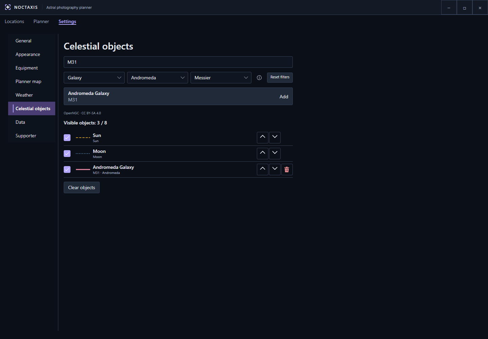
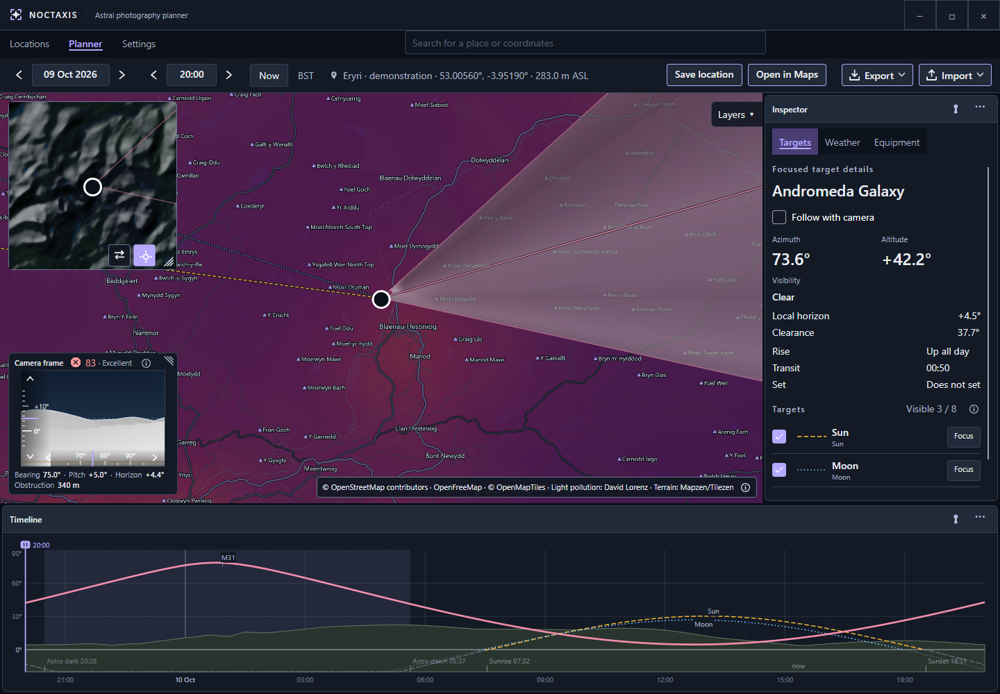
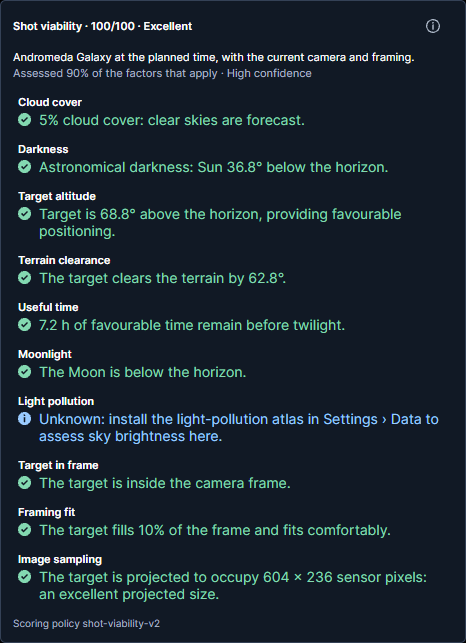
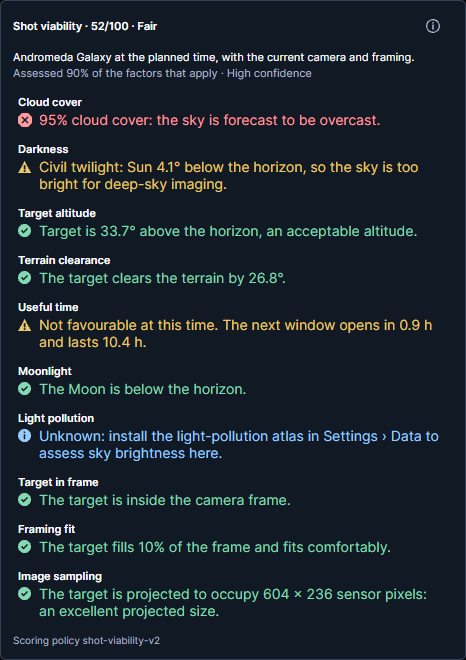
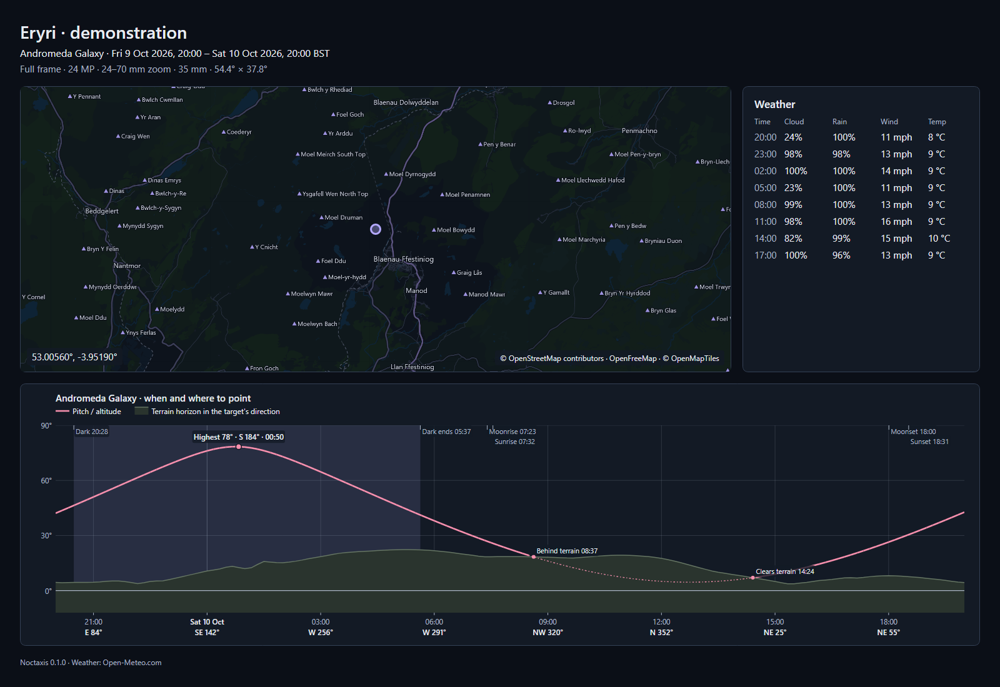

# Getting Started

This guide walks you through creating your first photography plan in Noctaxis, from choosing a location and equipment to exporting the result.

## Set your planning preferences

Open **Settings → General** and check the measurement system and planning time zone. The date and time shown in Planner use the displayed planning zone; check it when planning away from home.

Under **Settings → Appearance**, you can customise the application theme, adjust text size, enable a high-contrast theme, or select a colour-vision mode to improve visual accessibility.

## Set up your equipment

Before creating your first plan, configure your camera and lenses under **Settings → Equipment**. Noctaxis uses these details to calculate your camera's field of view and preview how celestial objects will fit within your composition.

### Camera

Add your camera and enter its specifications:

- **Sensor width and height (mm):** These determine your camera's field of view when combined with the selected lens and focal length. Accurate dimensions are essential for reliable framing.
- **Sensor resolution (px):** Optional, but recommended. The pixel dimensions allow Noctaxis to calculate image sampling and estimate how many pixels a celestial object will occupy.
- **Name, manufacturer and model:** Help identify your equipment. Manufacturer and model are optional.

You can find your camera's sensor dimensions and resolution in its technical specifications.

### Lens

Add each lens you intend to use, paying particular attention to its focal length:

- **Minimum focal length (mm):** The shortest focal length supported by the lens.
- **Maximum focal length (mm):** The longest focal length supported by the lens.
- **Name, manufacturer and model:** Help distinguish your lenses.

For a **prime lens**, enter the same value for both minimum and maximum focal length.

For a **zoom lens**, enter its full focal-length range, such as 16–50 mm.

Noctaxis combines the camera's sensor dimensions with the selected focal length to calculate the field of view. This determines the framing shown in the Planner and the camera's field-of-view overlay on the map.

Once your equipment is configured, you can select it directly from the Planner without entering these details again.

<!-- wiki-image:equipment-settings -->

*Sensor dimensions define framing; optional pixel resolution supports sampling information.*
<!-- /wiki-image:equipment-settings -->

### Camera height above ground

Set your **Camera height above ground**. This represents the height of your camera above the surrounding ground, typically the height of your tripod.

Noctaxis uses this value when calculating the terrain horizon and checking whether distant terrain might obstruct your view.

For example, raising your camera from ground level to a 1.5 m tripod can slightly change the calculated visibility of distant terrain.

This setting is separate from your location's elevation above sea level, which Noctaxis determines from terrain data.

## Add celestial targets

Before planning your shot, you can choose which celestial objects you want to work with under **Settings → Celestial objects**.

The Sun and Moon are included by default. Additional objects can be found using the built-in astronomical catalogue.

### Finding and adding objects

Use the search field to find an object by its name or catalogue designation, such as **M31** for the Andromeda Galaxy.

You can narrow your search using three filters:

- **Object type:** Find specific kinds of objects, such as galaxies, nebulae or star clusters.
- **Constellation:** Limit results to objects within a particular constellation.
- **Designation:** Filter objects by their catalogue designation.

Select **Add** beside an object to include it in your list.

For example, add M31 (Andromeda Galaxy) to prepare for the example in the following steps.

### Managing your targets

Your configured objects appear below the search controls, where you can manage which ones are displayed in the Planner.

The checkbox beside each object controls its visibility, while the arrow buttons let you rearrange the list. You can also remove objects you no longer need.

Noctaxis supports **up to eight visible celestial objects at once**, helping keep the map and Timeline readable.

You can add more than eight objects to your list, but only eight can be visible simultaneously. Additional objects remain available in your shortlist, ready to be enabled when needed.

<!-- wiki-image:celestial-objects -->

*Search and filters find catalogue objects; the configured list below controls visibility and order.*
<!-- /wiki-image:celestial-objects -->

## Choose a place and time

Open **Planner**, and search for a place using the search bar and select a result, or open a saved location from the **Locations** tab. Position the map pin at your intended camera position.

Choose the date and local time in the top bar. **Now** returns to the present. The Timeline lets you explore the following 24 hours.

## Select equipment and focus a target

In **Planner → Inspector → Equipment**, select the camera and lens you configured earlier, then choose your focal length and landscape or portrait orientation.

Under **Inspector → Targets**, choose which of your configured objects you want displayed. Select **Focus** on the object you're planning to photograph.

For our Andromeda example, make sure **M31** is visible and select **Focus**.

The Planner will now show information about your focused target, ready for you to explore its position, visibility and framing.

<!-- wiki-image:planner-overview -->

*Planner brings the camera position, composition and target paths into one workspace.*
<!-- /wiki-image:planner-overview -->

## Compose and assess the shot

Turn on **Follow with camera** to centre the camera on the focused target as time changes. Turn it off to compose independently by adjusting bearing and pitch in the Camera frame.

Scrub the Timeline to explore different moments. Check the target's altitude, terrain clearance, camera framing and weather. Open **Shot viability** to see an overall assessment, including contributing factors, warnings and data coverage.

### Comparing conditions

For M31, compare a moment shortly after dusk with one when the galaxy is higher in the sky. Consider how darkness, cloud cover, target altitude, light pollution and framing affect the suitability of each moment.

A higher score generally indicates more favourable conditions, but **always check the individual warnings**. Even a highly rated plan might have a significant drawback, such as heavy cloud cover.

Comparing different times and locations can help you understand the trade-offs and choose when and where to photograph.

<!-- wiki-image:viability -->

| Favourable conditions | Compromised conditions |
|:---:|:---:|
|  |  |
| **100/100 · Excellent** | **52/100 · Fair** |

*Both examples use M31, the same location and camera equipment, but at different times with simulated weather. The assessments are calculated by Noctaxis, with light-pollution data unavailable in both cases. Compare the individual warnings, not just the overall scores.*

<!-- /wiki-image:viability -->

## Keep the result

Choose **Save location** in Planner to bookmark a location. You can edit its name and description later in Locations.

To keep or share a plan, open **Export** and choose **Save PNG** or **Copy PNG**. You can reopen an exported plan image in Noctaxis to restore its essential planning details. Some equipment settings and preferences are not preserved.

<!-- wiki-image:plan-sheet -->

*An exported plan brings together your composition, target information and planning conditions in a single image.*
<!-- /wiki-image:plan-sheet -->

**Important:** Exported PNGs contain embedded planning data that allows Noctaxis to reopen them. Image compression tools, format conversions and some messaging or image-sharing services may remove this data. The image will still be viewable, but may no longer be reopenable as a plan. Keep the original exported PNG if you intend to import it again.

For more information, explore [Planner](planner.md) for detailed planning tools, [Locations](locations.md) for managing saved places, or [Settings](settings.md) to customise Noctaxis.
