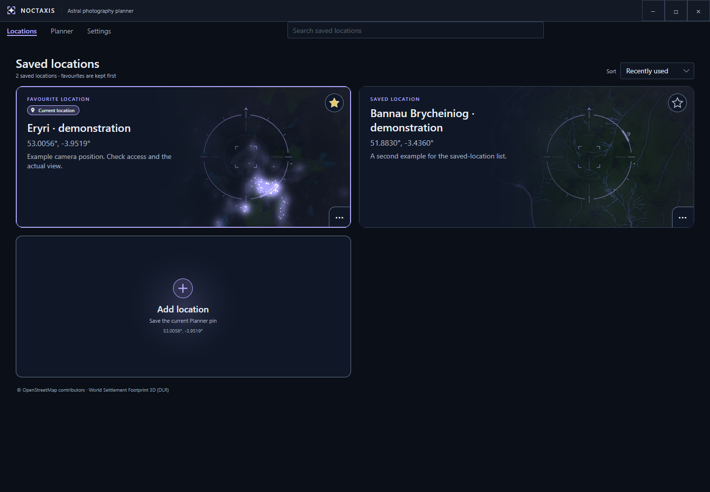

# Locations

Saved locations work like bookmarks for places you want to photograph from. They remember a place's coordinates, time zone, name and optional description, so you can easily return to it later.

Your position in Planner is independent of your saved locations. You can move the pin, search for somewhere new or explore different locations without changing anything you've already saved.

## Saving and opening locations

To open a saved location, simply select its card. Noctaxis will open it in Planner, mark it as your **Current location**, and update when it was last used.

There are two ways to save your current Planner position:

- **From Planner:** Select **Save location** to create a new bookmark with a suggested name. If the name already exists, Noctaxis automatically adds a number.
- **From Locations:** Select **Add location** to give your bookmark a name and optional description. If you haven't saved any locations yet, this option appears as **Save current location**.

Saving the same place more than once creates separate entries rather than replacing an existing bookmark.

To find somewhere new, use [Planner's place search](planner.md#choose-the-planning-position). The search field on the Locations page is only for places you've already saved.

<!-- wiki-image:locations -->

*Your saved locations are displayed as cards, with favourites kept at the top.*
<!-- /wiki-image:locations -->

## Finding and organising locations

Use the search field to filter saved locations by name, description or region.

You can mark frequently visited places as **favourites** to keep them at the top of your list. Locations can also be sorted by name, date added or most recently used.

## Editing and deleting locations

Each location card has a menu where you can edit its name and description, change its favourite status or delete it.

Editing a location won't change its coordinates. If you want to save a different camera position, move the pin in Planner and save it as a new location.

Deleting a bookmark only removes the saved entry. It won't change your current position in Planner.

## Location images

Each saved location includes a map image to help you recognise the area at a glance.

The **Skyglow compass** displayed over the image indicates the direction of nearby light pollution. Its arrow(s) points towards the nearest major source(s) of artificial light along the horizon, helping you identify potentially brighter areas of the night sky.

If an image is missing or needs updating, you can regenerate it from the location's menu. You can also refresh the underlying settlement imagery when newer data is available.

Image generation may use external map providers, but failures won't prevent you from using your saved locations.

To repair images across your entire collection, visit **Settings → Data → Repair saved map images**.

For more information, see [Settings](settings.md#data) or [Licensing & credits](about.md#licensing--credits).
