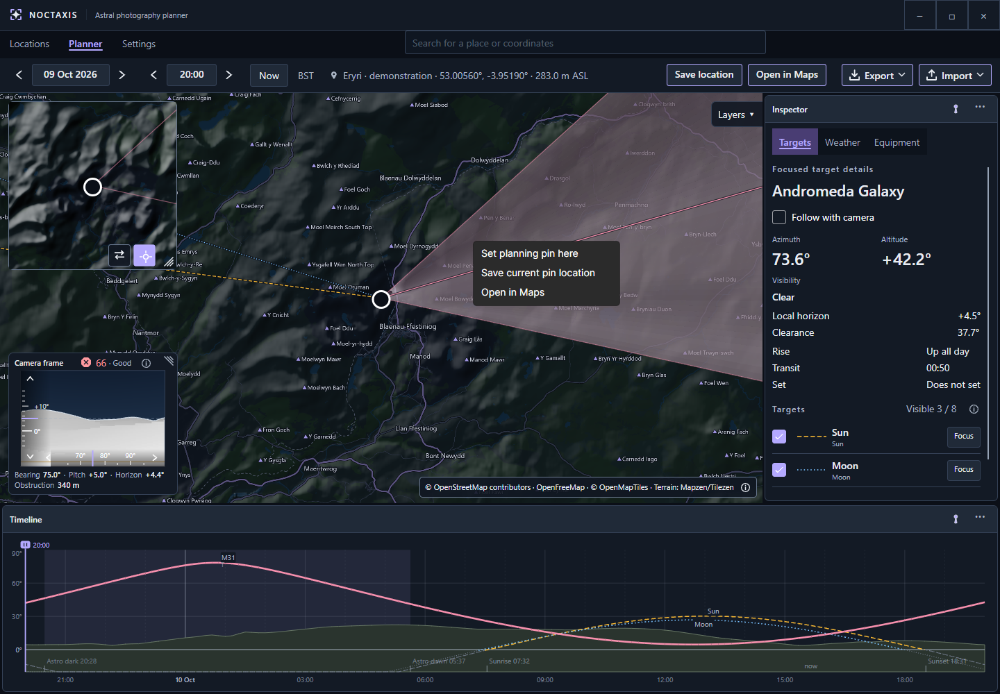
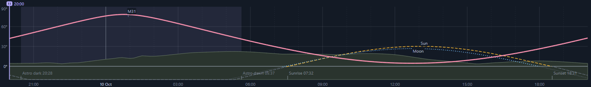
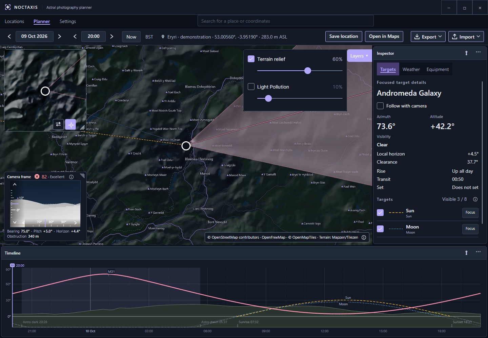
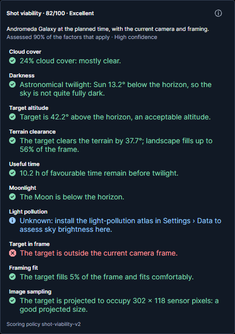

# Planner

Planner is where you choose a location and time, frame your shot and check the conditions before heading out. Your camera setup, celestial targets, terrain and weather are all brought together in one workspace.

## Find your way around

The map is at the centre of Planner. Above it, the top bar lets you search for places, set the date and time, save locations, and import or export plans.

The **Inspector** contains your Targets, Weather and Equipment. The **Timeline** shows how celestial objects move through the sky over time. The **Camera frame** helps you see what will fit in your shot, while the **Picture-in-Picture (PiP)** map gives you a second view of the surrounding area.

<!-- wiki-image:planner-overview -->

*The main map, Camera frame, Inspector and Timeline in one workspace.*
<!-- /wiki-image:planner-overview -->

## Arrange the workspace

You can move the **Inspector** and **Timeline** between their available dock positions, pin them or resize them. The Camera frame and PiP can also be resized. Noctaxis remembers your layout automatically.

To return to the default arrangement, use **Settings → Planner map → Reset Planner layout**. This also resets the overlay sizes and PiP zoom, but keeps the PiP centre, Follow pin and layer preferences.

## Choose the planning position

Search for a place in Planner, or open a saved location from Locations. Pan and zoom the map to find where you want to photograph from, then drag the pin to the exact position. You can also double-click the map to move the pin there.

You don't need to save a location to plan from it. If you want to return to it later, choose **Save location**. This creates a new saved location each time, rather than replacing an existing one. You can rename it or add a description in Locations.

The location bar shows your coordinates and camera altitude above sea level. Noctaxis combines the ground elevation with the **Camera height above ground** you've set under **Settings → Equipment**. The location details also indicate whether the ground elevation came from terrain data, a saved value or a fallback.

Use **Open in Maps** to view your current planning location in your preferred external map service, selected in Settings.

Alternatively, right-click anywhere on the map and select **Open in Maps** to open that specific position without moving your Planner pin.

<!-- wiki-image:planner-map-context-menu -->

*Open any map position in an external map service without changing your current plan.*

<!-- /wiki-image:planner-map-context-menu -->

## Set the date and time

Use the top bar to choose the date and time you want to plan for. The arrows move the date by one day or the time by 30 minutes. **Now** returns to the present.

Check the displayed time zone when planning somewhere away from home. Opening a saved location uses its stored time zone, while a place-search result can provide another one. The time-zone details show its identifier and UTC offset, which may change with daylight saving time.

Changing the time updates celestial positions and other time-dependent information. You can plan far beyond the available weather forecast, although weather will be shown as unavailable for those dates.

## Read and use the Timeline

The date and time in the top bar establish the start of the Timeline's **24-hour window**. Drag the time cursor to explore any point in the following 24 hours. Scrubbing doesn't move the start of the window, however, changing the date or time directly or selecting **Now** will set a new starting point.

The cursor moves in steps determined by the snap setting under **Settings → General**. You can still enter an exact time in the top bar.

Each visible object has a path showing its altitude as time passes. Focusing on an object gives you a closer look at its path and events. The Timeline also shows Sun and Moon events and periods of darkness, so you can compare the target's position with the available light. Different line patterns help distinguish objects without relying on colour alone.

A target can be above the astronomical horizon and still be hidden behind a hill. Use the Timeline alongside the terrain information when judging when it becomes visible.

<!-- wiki-image:timeline -->

*The Timeline lets you compare target altitude, terrain and daylight over a 24-hour period.*
<!-- /wiki-image:timeline -->

## Choose and focus targets

The Sun and Moon are included by default. You can add other objects under **Settings → Celestial objects**, then choose which ones to display from **Inspector → Targets**. Up to eight objects can be visible at once.

Visible objects appear on the map and Timeline. Select **Focus** to make one your main target. Its detailed readings, Shot viability assessment and exported plan will then relate to that object.

**Focus** and **Follow with camera** do different things. Focusing selects the target but it doesn't have to change where your camera points. With Follow enabled, the camera aims at the focused target and tracks its position as you change the plan. With Follow disabled, you can keep the target selected while composing the shot independently.

Hiding or removing the focused object clears its focus. The Inspector also shows relevant rise, transit and set information, together with terrain visibility such as clear, marginal, blocked or unavailable.

## Compose the camera view

Choose your camera and lens in **Inspector → Equipment**, then set the focal length and landscape or portrait orientation. The camera's sensor dimensions and the selected focal length determine how much of the scene fits in the frame.

The **Camera frame** shows the angular view through your selected equipment. Its **bearing (azimuth)** is the direction you're pointing, measured clockwise from north: east is 90° and south is 180°. **Pitch** is how far the camera points above or below the horizon. A celestial target's **altitude** describes its own angle above or below the horizon.

The field-of-view cone on the main map shows the camera's direction and approximate coverage from the planning pin. Turning the bearing rotates the cone, whilst changing pitch aims the Camera frame higher or lower.

With **Follow with camera** enabled, Noctaxis points the camera towards your focused target, so manual bearing and pitch controls are unavailable. Turn **Follow with camera** off again to aim freely. You can drag inside the Camera frame or use the arrow keys to move by **1° per step**; hold **Shift** for finer adjustments. You can invert either drag direction under **Settings → Planner map**.

Scrolling the mouse wheel over the Camera frame changes focal length, where the selected lens supports it. This widens or narrows the field of view without changing the camera's position.

The Camera frame also shows the modelled terrain horizon, helping you judge how much landscape sits within your composition and whether your target clears it. It does not include objects not included in the terrain map.

## Understand terrain and visibility

When terrain calculations are enabled, Noctaxis estimates the horizon around your planning position using ground elevation, camera height above ground and available land-cover data.

In the **Camera frame**, shaded areas represent landscape rather than open sky. Different shading helps separate nearer foreground from more distant terrain. The upper edge of the landscape is the estimated horizon in that direction. A ridge can occupy the bottom of your frame without necessarily blocking a target above it.

The terrain readouts help you interpret that view:

- **Horizon** is the estimated angle of the terrain horizon along the camera's bearing.
- **Clearance** helps you see how far a target sits above that horizon.
- **Obstruction** gives the approximate distance to the first modelled terrain blockage in that direction, or **Clear** if none is found. It's a bearing-based reading, not the distance to the celestial target or a measurement along the camera's current pitch.

The **Ignore terrain in the bottom of the frame** setting lets you tolerate some foreground landscape before the composition is considered obstructed. It changes the framing assessment, not the terrain itself or whether the target clears the horizon.

Terrain information can take time to load or become more detailed after moving the pin. If it's missing or incomplete, don't assume the view is clear. Trees, buildings and other small obstructions may not appear in the model. Likewise, forecast **visibility** describes atmospheric conditions, not whether a hill is in the way.

The **Terrain relief** map layer adds shading to show hills and valleys. It's a visual overlay, separate from the terrain calculations used by the Camera frame.

## Use map layers and PiP

Open **Layers** to display terrain relief or light pollution on the map. You can adjust the opacity of each overlay to control how prominently it appears, while roads, boundaries and place names remain clearly visible above them.

The light-pollution overlay uses the optional **Light Pollution Atlas 2025**, which you can install under **Settings → Data**. It shows modelled artificial sky brightness, not the cloud cover, moonlight or visibility forecast for a particular night. Its colour palette can be changed in **Settings → Planner map**.

The **PiP map** gives you a second view without losing your main map's setup. When you switch the two maps, each retains its own centre, zoom and overlay visibility and opacity. You can zoom PiP independently and choose whether **Follow pin** keeps it centred on the camera position or leaves it where you last placed it. Both maps share the light-pollution palette.

For example, you could keep the main map zoomed in on your shooting position and use PiP to see the wider area. Swap the maps if you want to adjust the smaller view at full size, then swap back.

Roads and labels, along with enhanced PiP contrast, can be adjusted in Settings. Map attribution remains visible for the active sources.

<!-- wiki-image:map-layers -->

*Use the two maps to compare different scales or overlays without losing your preferred views.*
<!-- /wiki-image:map-layers -->

## Read the weather

Open **Inspector → Weather** to see the conditions for your selected place and time. The information is organised into four groups:

- **Sky:** Cloud cover and layers, visibility and precipitation.
- **Conditions:** Temperature, humidity, dew point and wind.
- **Light:** Sunrise, sunset, twilight and astronomical darkness.
- **Moon:** Phase and illumination. Moonrise and moonset information is also available in the Moon's target details.

Weather forecasts come from Open-Meteo, while the daylight and Moon information also uses astronomical calculations. You can adjust which groups you see under **Settings → Weather**.

Forecasts are hourly estimates. Noctaxis may reuse recently downloaded weather for nearby locations; choose **Refresh** to request updated information. Check for stale or unavailable data before relying on a forecast.

You can still plan for dates beyond the forecast range. The astronomical calculations will work, but weather information won't be available for those dates.

## Interpret Shot viability

The **Shot viability** indicator in the Camera frame provides an advisory assessment of your focused target and current composition. Open it to see the **0–100 score**, its rating, individual factors, warnings and information about how complete the assessment is.

Noctaxis considers the conditions relevant to your target, including clouds, darkness, target altitude, terrain clearance, useful observing time, moonlight, light pollution, whether the target is in frame, how well it fits and image sampling. Some factors don't apply to every type of target; image sampling also requires your camera's pixel resolution.

Ratings range from **Very poor** to **Excellent**, with Poor, Fair and Good in between. A higher score generally means a more favourable plan, but it isn't a prediction of photographic success. **Read the warnings as well as the number.** A high-scoring plan can still have an important problem, such as a target outside the camera frame.

### Light pollution and missing information

For catalogue targets, Shot viability uses modelled artificial sky brightness from the installed Light Pollution Atlas at your planning pin. More artificial skyglow reduces that factor's score. The Sun and Moon aren't assessed against light pollution.

The score uses the atlas data even if the map overlay is hidden; changing the overlay's opacity or palette doesn't affect the calculation. If atlas data is missing, still loading or unavailable at that location, light pollution is marked unknown rather than treated as a dark sky. Moonlight and cloud cover are assessed separately.

The panel also reports **coverage** and **confidence**. Coverage tells you how much of the applicable assessment could be completed. Neither figure is a percentage chance of getting a successful photograph, and missing data can leave a favourable score based on fewer factors.

### What the assessment doesn't tell you

**Useful time** estimates a favourable observing window based on the astronomical and terrain conditions being assessed. It doesn't promise clear weather throughout that period.

Shot viability also doesn't assess atmospheric seeing, tracking accuracy, focus or optical image quality. It's there to help you compare plans and recognise trade-offs, not to prevent you from planning or exporting a shot.

<!-- wiki-image:shot-viability -->

*Check the individual factors and warnings, not just the overall score.*
<!-- /wiki-image:shot-viability -->

## Save, share and reopen a plan

Once you've focused a target and its Timeline path has finished calculating, open **Export**. Choose **Save PNG** to save a plan sheet or **Copy PNG** to put it on the clipboard.

The exported image brings together your focused target, location, equipment, map (where available), weather and a 24-hour chart. Noctaxis requests fresh weather for the export. If that fails, it uses suitable cached conditions with their retrieval time, or marks the weather as unavailable.

<!-- wiki-image:plan-sheet -->

*An exported plan sheet brings the details of your planned shot into one image.*
<!-- /wiki-image:plan-sheet -->

An exported PNG also contains embedded information that lets Noctaxis reopen the plan. This includes the coordinates, planning time, camera bearing and pitch, and focused-target and Follow settings.

To reopen it, use **Import → Open plan image…**, choose **Load from clipboard**, or drag a PNG into Planner. Noctaxis restores the supported planning details and recalculates the relevant information.

Not everything is restored. Equipment profiles, focal length, orientation, time-zone preference, map layers, theme and workspace layout remain as currently configured. If the imported target isn't in your configured list, add it under Settings and focus it again; importing doesn't add targets automatically.

**Keep your original exported PNG** if you want to reopen it later. Image editors, compression tools and messaging services can remove the embedded information even when the picture remains intact.

See [Settings](settings.md) for preferences and [Licensing & credits](about.md#licensing--credits) for information about the data and services Noctaxis uses.
