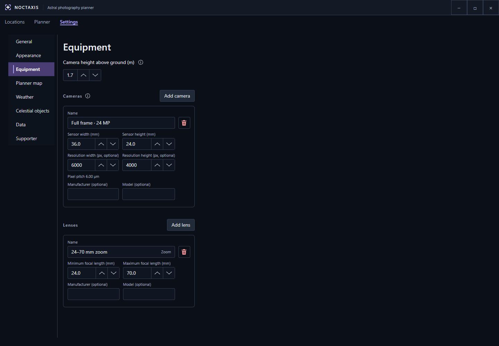

# Settings

Most settings save automatically. Equipment profiles are the exception: changes are saved only when you have at least one camera and one lens, and all their required fields are valid. If a profile is incomplete, your previously saved equipment is kept, but new equipment changes won't save until the required fields are corrected. Camera resolution is optional.

## General

**Language** controls the text in Noctaxis and, where supported, the language of place names on the map. Numbers and dates generally follow your operating system's regional settings, although some displays, including the Planner date and 24-hour clock, use fixed formats.

Currently supported interface languages:

| Language | Locale | Status |
| --- | --- | --- |
| English (United Kingdom) | `en-GB` | Supported |

The table will grow as more translations become available.

**Measurement system** lets you choose how temperatures, distances and other measurements are displayed. It doesn't change the calculations behind your plan.

| Profile | Temperature | Wind | Long distances | Heights | Rainfall |
| --- | --- | --- | --- | --- | --- |
| Metric | °C | km/h | km | m | mm |
| UK Mixed (default) | °C | mph | miles | m | mm |
| Imperial | °F | mph | miles | feet | inches |

Camera sensor dimensions and focal lengths are always entered in millimetres, and angles are shown in degrees.

**Planning time zone** determines how local dates and times are interpreted. Choose **System** to use your computer's time zone. Opening a saved location switches to its stored time zone, while a place-search result can also supply one. Check the zone displayed in Planner when planning somewhere away from home.

The **Timeline snap interval** controls how far the cursor moves when scrubbing or using the keyboard. You can still enter a precise time in the Planner top bar. You can also choose which service **Open in Maps** uses: OpenStreetMap, Google Maps or Mapillary.

## Appearance

Choose a theme, follow your system's light or dark appearance (or set one yourself), select a colour-vision mode and adjust text size from 100% to 200%.

**Noctaxis** and **High Contrast** are standard themes. Additional theme families are available to supporters; they change how the application looks, nothing more, nothing less.

Colour-vision modes for **Protanopia**, **Deuteranopia** and **Tritanopia** adjust the presentation to make information easier to distinguish. Celestial targets also use different line patterns, so you don't have to rely on colour alone.

If the default **Turbo** light-pollution palette is difficult to distinguish, try **Cividis** or **Grayscale** instead. Theme and palette choices don't affect planning calculations.

## Equipment

Add a camera profile using the sensor's **width and height in millimetres**. Use the dimensions of the sensor area you actually photograph with, as these determine the camera's field of view together with your lens.

Camera resolution is optional. Enter both the **width and height in pixels** as positive whole numbers if you want pixel-pitch calculations and image-sampling information in Shot viability. If you enter only one dimension, the profile can still save, but Noctaxis will remind you to complete it. Field-of-view planning works without resolution details.

For each lens, enter its **minimum and maximum focal lengths**. Use the same value for both if it's a prime lens. You can select your saved camera and lens, then adjust focal length and orientation, in Planner.

**Camera height above ground** is the height of your camera above the local ground, usually its position on a tripod. Noctaxis adds this to the ground elevation when calculating the terrain horizon.

<!-- wiki-image:equipment-settings -->

*Sensor dimensions determine framing; optional pixel resolution supports image-sampling information.*
<!-- /wiki-image:equipment-settings -->

## Planner map

Enable **terrain calculations** to account for hills and other modelled terrain when assessing the horizon and camera framing. If you turn them off, terrain results become unavailable.

**Ignore terrain in the bottom of the frame** controls how much foreground landscape you're willing to include before the framing assessment treats it as an obstruction.

You can choose whether camera framing and weather/terrain limits appear on the map, and adjust the appearance of planning overlays, including opacity and boundary thickness. **Horizontal** and **vertical drag inversion** reverse the corresponding Camera frame drag controls without changing what bearing and pitch mean.

You can enable or disable **PiP**, control its roads and labels, and enable enhanced contrast. The light-pollution colour palette is also selected here.

**Reset Planner layout** restores the panel positions, overlay sizes and PiP zoom. It doesn't change the PiP centre, Follow pin or your layer preferences.

## Weather

Choose which information to show under **Sky**, **Conditions**, **Light** and **Moon**. Turning off topics you don't use reduces what Noctaxis requests or displays without changing its astronomical calculations.

**Forecast reuse distance** determines how close another location must be before Noctaxis can reuse recently downloaded weather data. A smaller distance is useful when comparing nearby locations that might have different conditions. Using **Refresh** or exporting a plan requests fresh weather.

Weather forecasts cover a limited period, but you can still plan astronomical events beyond that range.

## Celestial objects

Search the built-in catalogue by name or designation, such as **M31** for the Andromeda Galaxy, and add the objects you want to use in Planner.

You can show or hide objects, rearrange them or remove ones you no longer need. Up to **eight objects can be visible at once**, but you can keep more in your list and enable them later.

The **Sun and Moon** are included by default. **Clear objects** removes added catalogue objects and restores the default list with the Sun and Moon visible.

## Data

The terrain cache stores downloaded elevation data so it can be reused. You can set a storage limit and see how much space the cache is using. When it exceeds the limit, Noctaxis removes data furthest from your saved locations first. If you haven't saved any locations, it removes the least recently used data instead. Files currently in use may remain until they're released.

**Clear terrain cache** deletes downloaded terrain data, which Noctaxis may need to download again. It doesn't remove your saved locations or equipment profiles.

The optional **Light Pollution Atlas 2025** is not installed automatically. Install it here if you want the light-pollution map layer and its contribution to Shot viability. You can also remove the atlas and view its source information.

**Repair saved map images** provides options to reapply image styling, refresh settlement imagery or regenerate all saved-location map images. Choose the option that matches the problem. If an optional image provider fails, your saved locations remain usable.

## Supporter

You can enter or replace your **Awoo supporter licence**, check its status or open the support page here. Supporter access unlocks additional cosmetic themes. Core planning tools, High Contrast, colour-vision modes and text scaling remain available without it.

The [Noctaxis Supporter System](../../AWOO-SUPPORTER-SYSTEM.md) defines which features are included and the terms of supporter access. Being a supporter doesn't grant commercial-use permission.

For more detail about using these settings, see [Planner](planner.md). For information on the software and data providers, see [Licensing & credits](about.md#licensing--credits).
